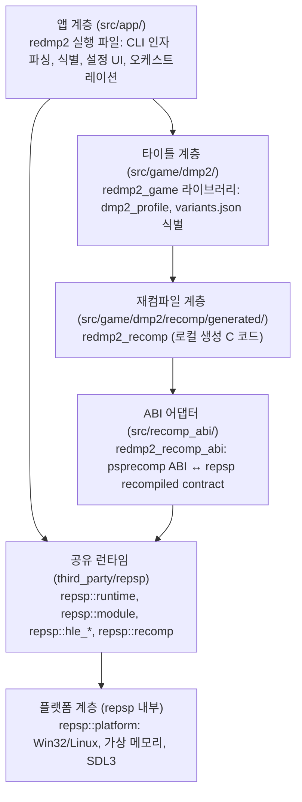
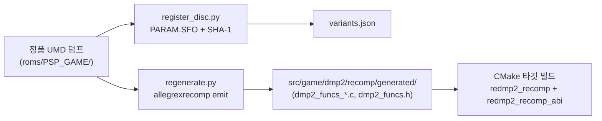
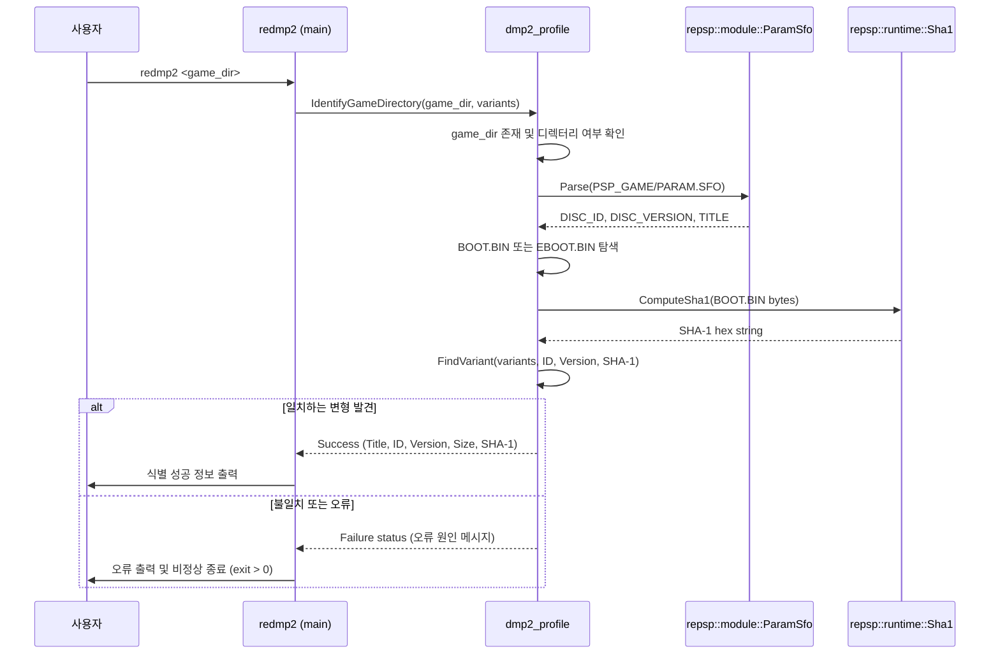

# 아키텍처 (ARCHITECTURE)

이 문서는 reDMP2 프로젝트의 레이어 구조, 컴포넌트 간 의존성, 재컴파일 파이프라인 및 실행 흐름을 정의합니다. 저장소 구조와 ABI 어댑터(`src/recomp_abi/`)는 [reexec/reDMP1](https://github.com/reexec/reDMP1)(v0.0.30, `dadb6da`)에서 이식했습니다.

---

## 1. 레이어 구조 및 의존성 규칙

reDMP2는 엄격한 단방향 의존성 계층 구조를 따릅니다. 상위 레이어는 오직 직속 하위 레이어의 공개 인터페이스(public contract)만 참조하며, 하위 레이어는 상위 레이어의 존재나 타이틀 고유 정보를 알지 못합니다.

### 레이어별 역할

1. **`app` (`src/app/`, 타깃 `redmp2`)**:
   * 애플리케이션 진입점(`main.cpp`), 설정 파일(`settings.*`, `redmp2.ini`), 내부 설정 UI(`settings_ui.*`).
   * 사용자 명령줄 인자(`--variants`, `--lift-check`, `--headless`, `--renderer`, `--scale`, `--post-shader`, `--audio-latency-ms`, `--max-vblanks`, `--input-script`, `--save-dir`, `--dialog-answer`, `--codec-plugin`, `--no-codec-plugin`, `--crash-dir`, `--no-input-record`, `--debug-crash`, 게임 디렉터리 경로) 파싱 및 옵션 처리.
   * `redmp2_game`의 `IdentifyGameDirectory`를 호출하여 게임 디스크 유효성 검사.
   * 기본 실행(`REDMP2_HAVE_RECOMP=1`) 시 `repsp::platform::Initialize`, `LoadPrx`, `repsp::hle::kernel::Register`, `ge`, `display`, `ctrl`, `dmac`, `audio`, `sascore`, `atrac`, `mpeg`(선택적 `repsp_codec_ffmpeg` 동적 로드 포함), `utility`를 등록하고 `Scheduler::CreateThread("module_start")` 및 `GuardedRun`으로 실행을 오케스트레이션합니다.
2. **`game/dmp2` (`src/game/dmp2/`, 타깃 `redmp2_game`)**:
   * DJ Max Portable 2(`ULKS-46116`, 버전 `1.09`) 타이틀 고유 메타데이터와 프로파일 정의(`include/redmp2/dmp2_profile.h`).
   * `variants.json` 파싱 및 디스크 식별 로직.
   * `repsp::module::ParamSfo`를 사용하여 `PSP_GAME/PARAM.SFO`로부터 `DISC_ID`, `DISC_VERSION`, `TITLE` 추출.
   * `repsp::runtime::ComputeSha1`을 사용하여 후보 실행 파일의 SHA-1 해시 검증.
3. **`recomp_abi` (`src/recomp_abi/`, 타깃 `redmp2_recomp_abi`)**:
   * `allegrexrecomp`가 기계적으로 생성한 C 코드가 호출하는 `psprecomp` ABI 인터페이스(`psp_cpu`, `psp_read*`, `psp_write*`, `psp_hle_call`, `psp_syscall`, VFPU 연산자 등)를 구현하여 `repsp`의 재컴파일 코드 계약(`include/repsp/recomp/guest_cpu.h`) 및 메모리 계층에 바인딩합니다.
   * `cpu.c`, `mem.c`, `dispatch.c`, `trap.c`, `trace.c`, `exec_trace.cpp`, `vfpu.c`로 구성됩니다.
   * **`repsp`는 `psprecomp`에 의존하지 않으며**, 어댑터는 reDMP2 내부에 위치합니다(reDMP1에서 복사, 별도 저장소 분리 여부는 추후 결정).
4. **`recomp` (`src/game/dmp2/recomp/generated/` 또는 `-DREDMP2_GENERATED_DIR`, 타깃 `redmp2_recomp`)**:
   * `allegrexrecomp emit`으로 로컬에서 기계적으로 생성하는 C 구현체(`dmp2_funcs_*.c` + `dmp2_imports.c` + `dmp2_register.c`).
   * `redmp2_recomp_abi`를 통해 런타임과 연결되며, `redmp2` 실행 파일에 정적 라이브러리로 링크됩니다.
5. **`repsp` (`third_party/repsp`, 공유 서브모듈)**:
   * 타이틀 중립적이며 독립적으로 재사용 가능한 PSP 런타임 라이브러리(`GuestMemory`, `NidRegistry`, `ParamSfo`, `GuardedRun`, HLE 모듈, SDL3/OpenGL 플랫폼 백엔드).

---

## 2. 재컴파일 파이프라인

1. **`register_disc.py`**:
   * 게임 폴더 내 `PARAM.SFO`에서 디스크 ID(`ULKS46116`)와 버전(`1.09`)을 추출하고 `BOOT.BIN`의 SHA-1 다이제스트를 계산하여 `variants.json`에 등록합니다.
2. **`allegrexrecomp` (호스트 도구)**:
   * `third_party/psprecomp/tools/allegrexrecomp`의 소스에 `patches/psprecomp/` 패치(`0001`~`0006`)를 빌드 디렉터리 복사본에 적용해 호스트 실행 파일로 빌드합니다.
3. **`regenerate.py`**:
   * `BOOT.BIN`을 lift 입력으로 선택하여 `allegrexrecomp emit`을 실행하고 `src/game/dmp2/recomp/generated/`에 C 코드를 갱신합니다.

---

## 3. 실행 디렉터리 및 디스크 식별 흐름

---

# Architecture (English)

This document describes reDMP2's layer structure, component dependencies, recompilation pipeline, and runtime flow. The repository layout and ABI adapter (`src/recomp_abi/`) are ported from [reexec/reDMP1](https://github.com/reexec/reDMP1) (v0.0.30, `dadb6da`).

## 1. Layers and Dependency Rules

* **`app` (`src/app/`, target `redmp2`)**: Application entry point (`main.cpp`), settings persistence (`settings.*`, `redmp2.ini`), Dear ImGui settings UI (`settings_ui.*`), CLI argument parsing, and orchestration. When built with generated code (`REDMP2_HAVE_RECOMP=1`), default execution initializes `repsp::platform`, loads `BOOT.BIN` via `LoadPrx`, registers the repsp HLE modules (`kernel`, `ge`, `display`, `ctrl`, `dmac`, `audio`, `sascore`, `atrac`, `mpeg` with optional dynamic `repsp_codec_ffmpeg`, `utility`), creates `module_start`, and runs `Scheduler::Run` under `GuardedRun`.
* **`game/dmp2` (`src/game/dmp2/`, target `redmp2_game`)**: Title profile (`ULKS-46116`, v1.09), variant identification, SFO parsing via repsp, and SHA-1 validation.
* **`recomp_abi` (`src/recomp_abi/`, target `redmp2_recomp_abi`)**: Adapter implementing psprecomp ABI symbols and forwarding to repsp's lifter-neutral recompiled-code contract. repsp does not depend on psprecomp. Copied from reDMP1; splitting into a shared repository is deferred.
* **`recomp` (`src/game/dmp2/recomp/generated/` or `-DREDMP2_GENERATED_DIR`, target `redmp2_recomp`)**: Locally generated C code produced by `allegrexrecomp emit`, linked statically into `redmp2`.
* **`repsp` (`third_party/repsp`)**: Shared title-neutral PSP runtime (`GuestMemory`, `NidRegistry`, `ParamSfo`, `GuardedRun`, HLE modules, SDL3/OpenGL platform backends).

## 2. Recompilation Pipeline

1. `register_disc.py`: Reads `PARAM.SFO` and computes `BOOT.BIN` SHA-1 to register the disc into `variants.json`.
2. `allegrexrecomp`: Host tool built from `third_party/psprecomp` with `patches/psprecomp/` (`0001`..`0006`) applied in the build directory.
3. `regenerate.py`: Selects `BOOT.BIN` as plain ELF lift input and invokes `allegrexrecomp emit` into `src/game/dmp2/recomp/generated/`.

## 3. Disc Identification Flow

`redmp2` verifies `PSP_GAME/PARAM.SFO` and `BOOT.BIN` SHA-1 against `variants.json`. If matched, it prints identification details (and proceeds to boot when built with generated code); otherwise it prints diagnostics and exits with a non-zero code.
