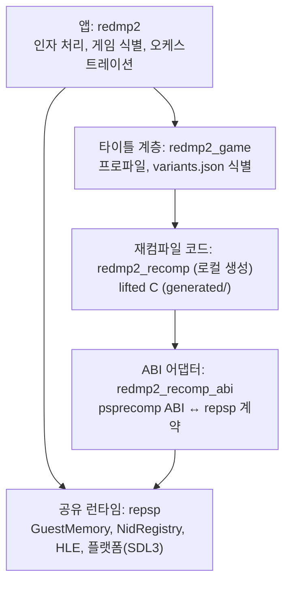

# reDMP2

DJ Max Portable 2(한국판, `ULKS-46116`, 디스크 버전 1.09, [redump.org #33115](http://redump.org/disc/33115/))를 에뮬레이터 없이 Win64 및 Linux x64에서 네이티브로 실행하는 정적 재컴파일(static recompilation) 및 디컴파일 오픈소스 프로젝트입니다. 저장소 구조, 규칙, ABI 어댑터 및 앱 골격은 [reexec/reDMP1](https://github.com/reexec/reDMP1)(v0.0.30, `dadb6da`)에서 이식했습니다.

---

## 프로젝트 개요

이 프로젝트는 원본 PSP UMD의 Allegrex MIPS 코드를 C 코드로 정적으로 재컴파일(lift)하고, 사람이 읽을 수 있는 C/C++ 코드로 점진적으로 디컴파일하여 네이티브 바이너리로 실행합니다.

* **재컴파일(Recompilation)**: [sp00nznet/psprecomp](https://github.com/sp00nznet/psprecomp)의 `allegrexrecomp` 도구를 호스트 도구로 빌드하여 원본 ELF의 기계어 코드를 기계적으로 C로 변환합니다.
* **디컴파일(Decompilation)**: 변환된 C 함수를 사람이 유지보수 가능한 C/C++로 하나씩 대체하며 원본 동작과의 동등성을 검증합니다.
* **PSP 런타임 및 플랫폼 백엔드**: 재사용 가능한 공유 PSP 런타임 라이브러리인 [reexec/repsp](https://github.com/reexec/repsp)를 통해 가상 메모리 관리, NID 임포트 디스패치, HLE(시스템 콜/OS 라이브러리), SDL3 기반 플랫폼 계층(창, 입력, 오디오)을 제공받습니다.



> [!IMPORTANT]
> **게임 데이터 미포함 안내**: 이 저장소에는 ISO, `BOOT.BIN`, `EBOOT.BIN`, PRX 모듈, 그래픽/음원 자산 등 일체의 저작권 보호 대상 원본 게임 데이터가 포함되어 있지 않습니다. 사용자는 직접 소유한 정품 UMD 미디어에서 추출한 덤프 디렉터리(`roms/`)를 제공해야 합니다.

---

## 빌드 방법

### 사전 요구사항

* **Windows**:
  * Visual Studio 2022 (v17) C++ 데스크톱 개발 워크로드
  * CMake 3.25 이상
  * Python 3.10 이상
* **Linux (Ubuntu 24.04)**:
  * GCC 13+ 또는 Clang 16+
  * CMake 3.25+, Ninja
  * SDL3 의존 라이브러리 (ALSA, PulseAudio, X11, Wayland, OpenGL/EGL 개발 패키지)

### 서브모듈 초기화

```bash
git submodule update --init --recursive
```

### Windows (Win64) 빌드

CMakePresets를 사용하여 빌드합니다:

```powershell
# Debug 구성
cmake --preset win64-debug
cmake --build build/win64-debug --config Debug
ctest --test-dir build/win64-debug -C Debug --output-on-failure

# 또는 제공되는 빌드 스크립트 사용
.\scripts\build_win64.ps1 -Config Debug
```

### Linux (x64) 빌드

```bash
# Debug 구성
cmake --preset linux-x64-debug
cmake --build build/linux-x64-debug
ctest --test-dir build/linux-x64-debug --output-on-failure

# 또는 제공되는 빌드 스크립트 사용
./scripts/build_linux.sh Debug
```

---

## 실행 및 파이프라인 사용법

### 1. 디스크 덤프 배치 및 등록

추출한 UMD 파일들을 디스크 ID별 하위 폴더에 배치합니다(`roms/ULKS46116/`에 DMP2 필수, `roms/ULKS46050/`은 링크 디스크용 DMP1 선택 — 없거나 비어 있어도 DMP2는 정상 동작합니다):

```text
roms/
├─ ULKS46116/          DMP2 (필수)
│  ├─ PSP_GAME/
│  └─ UMD_DATA.BIN
└─ ULKS46050/          DJMAX Portable 1 (선택, 링크 디스크)
   └─ PSP_GAME/ ...
```

디스크 모음 폴더(`roms`) 또는 개별 디스크 폴더(`roms/ULKS46116`) 모두 사용할 수 있습니다. `variants.json`에 등록합니다:

```powershell
python scripts/recomp/register_disc.py roms
# 또는: python scripts/recomp/register_disc.py roms/ULKS46116
```

### 2. C 코드 재생성 (Lifting)

호스트 도구 `allegrexrecomp`를 통해 실행 파일에서 C 코드를 추출합니다:

```powershell
python scripts/recomp/regenerate.py roms
```

생성된 C 소스 파일들은 `src/game/dmp2/recomp/generated/`에 배치되며, Git 추적에서 자동으로 제외됩니다.

### 3. 게임 실행 및 식별 검증

```powershell
.\build\win64-debug\Debug\redmp2.exe roms
# 또는: .\build\win64-debug\Debug\redmp2.exe roms/ULKS46116
```

### 단축키, 내부 설정 메뉴, `redmp2.ini`

* **단축키**
  * `Tab` 또는 게임패드 `LT+RT+Y`: 내부 설정 메뉴(OpenGL 렌더러 전용) 열기/닫기. 메뉴가 열린 동안 게임 입력은 차단됩니다.
  * 게임패드 `LT+RT+L3+R3` (1초 누르기): 게임 종료 (OpenGL·소프트웨어 렌더러 모두 지원)
  * `Alt+1..6`: 창 크기를 `480x272`의 1~6배로 조절 (전체화면·최대화 해제 후 적용)
  * `Alt+Enter` 또는 창 더블클릭(메뉴 창 밖): 데스크톱 해상도 테두리 없는 전체화면 토글
  * `Ctrl+1..8`: OpenGL 내부 렌더링 해상도(1x~8x) 변경
* **내부 설정 메뉴**: `Info`(빌드·게임·OpenGL·메모리 정보 및 `Link disc` 디스크 교체), `Graphics`(렌더링 배율·창 크기·전체화면·VSync·화면 비율·출력 필터·MSAA·텍스처 필터링·화면 셰이더(`none`, `crt`, `scanline`, `fsr`, `scalefx`, `anime4k` 및 `shaders/`의 `.glsl`/`.glslp`)·통계 창 표시 항목), `Audio`(음악 시작 오프셋 `Music offset (ms)`, -300~+300 ms, 5 ms 단위), `Input`(`Autoplay` 토글, 키보드·게임패드 매핑표 및 단축키 안내)와 드래그 가능한 통계 그래프 창(FPS, 메모리, GPU 메모리)을 제공합니다. `Autoplay`가 켜져 있고 플레이 장면인 동안 화면 오른쪽 위에 `AUTOPLAY` 표시가 나타나며, 실행마다 꺼진 상태로 시작하고 `redmp2.ini`에는 저장하지 않습니다(`--autoplay` 명령줄 옵션으로도 켤 수 있습니다).
* **저장 위치(`--save-dir`) 및 링크 디스크**: `--save-dir <경로>`는 메모리 스틱 루트(`ms0:`)를 지정하며, 세이브 데이터는 `<경로>/PSP/SAVEDATA`에 저장됩니다(기본값 `<user_data>/ms0`). 예전 기본 위치(`<user_data>/savedata`)에 세이브가 있고 새 위치가 비어 있으면 처음 실행 시 자동으로 옮깁니다. `roms/` 아래에 `PSP_GAME/USRDIR`를 갖춘 다른 디스크(예: `roms/ULKS46050/`)가 있으면 OSD `Info` 탭의 `Link disc` 절에서 게임이 교체를 허용할 때 디스크를 넣고 다시 DMP2로 되돌릴 수 있습니다(`--insert-disc <vblank>:<disc_id|main>` 명령줄 옵션도 지원).
* **설정 파일 (`redmp2.ini`)**: 실행 파일 옆에 저장하며, 해당 폴더에 쓸 수 없으면 사용자 데이터 폴더(`GetUserDataDirectory("redmp2")`)에 저장합니다. `[Graphics]` 항목 외에 `[Audio]`의 `MusicOffsetMs`(기본 0)를 저장합니다. `--scale`, `--renderer`, `--post-shader <id>` 명령줄 옵션과 `REDMP2_POST_SHADER` 환경 변수가 파일(`PostShader`)보다 우선하며, 명령줄·환경 변수로 지정한 값은 해당 실행에만 적용되고 파일에 덮어쓰지 않습니다.
* **진단 환경 변수 (기본 꺼짐)**: `REDMP2_MEM_DUMP=<경로>`와 `REDMP2_MEM_DUMP_VBLANK=<vblank>`를 함께 지정하면 지정한 vblank에 게스트 유저 RAM(`0x08800000`, 24 MiB)을 1회 파일로 기록합니다.

---

## 플랫폼 지원 현황

| 플랫폼 | 아키텍처 | 상태 | 비고 |
|---|---|---|---|
| Windows | x64 (Win64) | **부트스트랩 진행 중** | 1차 개발 플랫폼, Visual Studio 2022 |
| Linux | x64 | **CI 구성됨** | Ubuntu 24.04, GCC/Clang + Ninja |
| Windows | x86 (Win32) | 계획됨 | 향후 32비트 포팅 예정 |
| Linux | x86 | 계획됨 | 향후 32비트 포팅 예정 |
| Web | WebAssembly | 계획됨 | Emscripten 및 WebGL 기반 |
| Android | ARM64 | 계획됨 | NDK 및 OpenSL/Vulkan 기반 |

---

## 라이선스 및 상표 고지

* **소스 코드 라이선스**: 이 프로젝트의 자체 소스 코드는 [MIT License](LICENSE)에 따라 배포됩니다.
* **서드파티 라이선스**: 서드파티 오픈소스 의존성에 대한 고지는 [THIRD_PARTY_NOTICES.md](THIRD_PARTY_NOTICES.md)를 참조하십시오.
* **상표권 고지**: `DJMAX`, `DJ Max Portable 2`, `PENTAVISION` 및 관련 상표, 로고, 저작물은 주식회사 네오위즈(NEOWIZ) 및 관련 권리자의 등록 상표 또는 자산입니다. 이 프로젝트는 순수 오픈소스 리버스 엔지니어링 및 보존 목적의 비공식 연구 프로젝트이며, 네오위즈와 어떠한 제휴나 후원 관계도 없습니다.

---

# reDMP2 (English)

An open-source static recompilation and decompilation project to run DJ Max Portable 2 (Korea build, `ULKS-46116`, disc version 1.09, [redump.org #33115](http://redump.org/disc/33115/)) natively on Win64 and Linux x64 without an emulator. The repository layout, rules, ABI adapter, and application skeleton are ported from [reexec/reDMP1](https://github.com/reexec/reDMP1) (v0.0.30, `dadb6da`).

## Overview

reDMP2 lifts the Allegrex MIPS code from the original PSP UMD into C and incrementally replaces lifted functions with human-readable, verified C/C++ code.

* **Recompilation**: Uses `allegrexrecomp` from [sp00nznet/psprecomp](https://github.com/sp00nznet/psprecomp) as a host tool to mechanically lift MIPS code into C.
* **Decompilation**: Progressively replaces lifted functions with maintainable C/C++ while verifying behavioral equivalence.
* **PSP Runtime & Platform**: Backed by the shared portable PSP runtime [reexec/repsp](https://github.com/reexec/repsp) for memory management, NID dispatch, HLE syscalls, and SDL3 platform backends.

## Game Data Notice

**No copyrighted game data is included.** Users must provide their own dump extracted from legitimate UMD media in `roms/`.

## Building

```bash
# Submodules
git submodule update --init --recursive

# Win64
cmake --preset win64-debug
cmake --build build/win64-debug --config Debug
ctest --test-dir build/win64-debug -C Debug --output-on-failure

# Linux x64
cmake --preset linux-x64-debug
cmake --build build/linux-x64-debug
ctest --test-dir build/linux-x64-debug --output-on-failure
```

## Running

Place extracted UMD dumps per disc ID under `roms/` (`roms/ULKS46116/` for DMP2 is required; `roms/ULKS46050/` for DMP1 link disc is optional and may be absent or empty). Both the collection folder (`roms`) and a direct disc folder (`roms/ULKS46116`) are accepted:

1. Register disc: `python scripts/recomp/register_disc.py roms`
2. Generate lifted C: `python scripts/recomp/regenerate.py roms`
3. Run: `./build/win64-debug/Debug/redmp2 roms` (or `roms/ULKS46116`)

### Shortcuts, In-Game Menu, and `redmp2.ini`

* **Shortcuts**
  * `Tab` or gamepad `LT+RT+Y`: Toggle the Dear ImGui settings menu (OpenGL renderer only). Game input is withheld while open.
  * Gamepad `LT+RT+L3+R3` (hold 1 s): Quit the app (works on both OpenGL and software renderers).
  * `Alt+1..6`: Resize the window to 1x..6x of `480x272` (leaves fullscreen/maximized first).
  * `Alt+Enter` or double-click outside menu windows: Toggle borderless desktop-resolution fullscreen.
  * `Ctrl+1..8`: Set the OpenGL internal rendering scale (1x..8x).
* **In-Game Menu**: `Info` (build, game ID/title, OpenGL, memory), `Graphics` (render scale, window scale, fullscreen, VSync, aspect ratio, output filter, MSAA, texture filtering, screen shader, stats toggles), `Audio` (`Music offset (ms)` slider, -300 to +300 ms in 5 ms steps), `Input` (`Autoplay` toggle, keyboard/gamepad mapping and shortcut reference), plus a draggable stats overlay (FPS, process memory, GPU memory). When `Autoplay` is enabled during gameplay, a small `AUTOPLAY` badge is shown at the top right; it always starts off per run and is not saved to `redmp2.ini` (also selectable with `--autoplay`).
* **Settings File (`redmp2.ini`)**: Saved next to the executable, falling back to the user data directory if not writable. Stores `[Graphics]` options and `[Audio]` `MusicOffsetMs` (default 0). Command-line options (`--scale`, `--renderer`, `--post-shader <id>`) and `REDMP2_POST_SHADER` override the file (`PostShader`) for that run without overwriting it.
* **Diagnostics (off by default)**: Setting both `REDMP2_MEM_DUMP=<path>` and `REDMP2_MEM_DUMP_VBLANK=<vblank>` dumps guest user RAM (`0x08800000`, 24 MiB) once at the target vblank.

## License & Trademark Notice

Licensed under the MIT License. See [LICENSE](LICENSE) and [THIRD_PARTY_NOTICES.md](THIRD_PARTY_NOTICES.md). DJ Max Portable 2 is a registered trademark of NEOWIZ. This project is unofficial and not affiliated with NEOWIZ.
