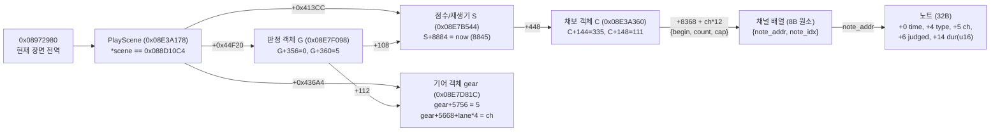
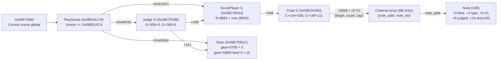

# 자동 플레이를 위한 DMP2 메모리 구조 분석 (issue #17)

* 대상 실행 파일: `BOOT.BIN` (`ULKS-46116`, v1.09, `ET_EXEC`, 기준 `0x08804000`, SHA-1 `1a5c904989d430588da9653acad4b6c5cdab2885`)
* 설계: [20261122-i017-autoplay.md](../design/20261122-i017-autoplay.md)
* 작업 지시: [20261122-i017-autoplay.md](../work-orders/20261122-i017-autoplay.md)
* 라이브 측정 조건: `build\win64-release-ffmpeg\Release\redmp2.exe` (FFmpeg 플러그인 자동 로드), `--headless --max-vblanks 4500`, 4B `Ladymade Star` NM 플레이 중 `REDMP2_MEM_DUMP_VBLANK=4200`에서 유저 RAM(`0x08800000`, 24 MiB) 덤프. `REPSP_FRAME_DUMP`의 `frame_1950.bmp`에서 4레인 기어·하강 노트·`BREAK` 판정 화면을 확인했다(`presented=2099`, `Dispatches=0`, `Exit=0`).

## 포인터 체인 개요 (**확인됨**)

---

## 1. 패드 입력 (**확인됨**)

* **`sceCtrlReadBufferPositive` 호출 지점**: `psp_func_08831FDC` (`dmp2_funcs_029.c`)가 `psp_import_088C0718`(NID `0x1F803938`)을 버퍼 **`0x08976864`**(`0x08970000 + 26724`), count `1`로 호출한다.
* **현재·이전 버튼 및 아날로그 상태**:
  * `0x08976864` (`SceCtrlData`, 16B): `+0` `TimeStamp`, `+4` `Buttons` (`u32`), `+8` `Lx` (`u8`), `+9` `Ly` (`u8`).
  * `0x0897684E` (`0x08970000 + 26702`, `u16`): 현재 프레임 버튼(`Buttons & 0xFFFF`).
  * `0x0897684C` (`0x08970000 + 26700`, `u16`): 직전 프레임 버튼(`psp_func_08831FC8`에서 `0x0897684E`를 복사).
  * `psp_func_08832024(bit_idx)`: 방금 눌림(`IsJustPressed`) 판정.
  * `psp_func_08832068(bit_idx)`: 눌림 유지(`IsHeld`) 판정(`(cur & (1 << bit_idx)) != 0`).
  * `0x08976851` (`0x08970000 + 26705`, `u8`): 아날로그 스틱 입력 상태(`psp_func_088320A4(Lx, Ly)`가 갱신, `psp_func_08832210()`이 반환).
* **vblank 4200 측정값**:
  * `0x08976864`: `TimeStamp=70035234`, `Buttons=0x00000000`, `Lx=128`, `Ly=128`
  * `0x0897684E = 0x0000`, `0x0897684C = 0x0000`, `0x08976851 = 0x00`

---

## 2. 버튼 → 레인 변환 및 모드별 배치 표 (**확인됨**)

* **모드 바이트**: **`0x0897298D`** (`0x08970000 + 10637`, `u8`). `0`=4B, `1`=5B, `2`=6B, `3`=8B. vblank 4200 측정값 `0`(4B).
* **라이브 키 설정 테이블**: **`0x089756D0`** (`0x08970000 + 22224`), 모드당 **11바이트** 스트라이드. 각 바이트는 `psp_func_08832068`에 넘기는 PSP 버튼 **비트 인덱스(`0..15`, 마스크 `1u << idx`)** 다.
  * DMP1은 배치 번호에 따라 코드에 고정된 비트 마스크를 썼지만, DMP2는 RAM의 키 설정 테이블을 직접 읽으므로 `autoplay.cpp`가 테이블을 직접 읽으면 사용자 키 변경도 자동으로 따른다.
* **모드별 변환 함수** (`PlayScene + 0x450EC`의 서브 컨트롤러 `vtable + 40`, `0x0885246C`/`0x08852570`에서 모드별로 생성):

| 모드 (`0x0897298D`) | 테이블 주소 | 싱글플레이 변환 함수 | 레인 비트 매핑 (테이블 오프셋) | vblank 4200 측정값 (기본 키 배치) |
|---|---|---|---|---|
| `0` (4B) | `0x089756D0` | `0x08864784` (`dmp2_funcs_058.c`) | 레인 `0..3` ← `[0], [1], [4], [5]` | `7(LEFT), 4(UP), 12(TRIANGLE), 13(CIRCLE)` |
| `1` (5B) | `0x089756DB` | `0x0886EE50` (`dmp2_funcs_064.c`) | 레인 `0,1,3,4` ← `[0], [1], [4], [5]`; 중앙 레인 `2` ← `[2]` **또는** `[3]` | `7(LEFT), 4(UP), 5(RIGHT)\|15(SQUARE), 12(TRIANGLE), 13(CIRCLE)` |
| `2` (6B) | `0x089756E6` | `0x0886F024` (`dmp2_funcs_064.c`) | 레인 `0..5` ← `[0], [1], [2], [3], [4], [5]` | `7(LEFT), 4(UP), 5(RIGHT), 15(SQUARE), 12(TRIANGLE), 13(CIRCLE)` |
| `3` (8B) | `0x089756F1` | `0x0886F19C` (`dmp2_funcs_064.c`) | 레인 `0..7` ← `[6], [0], [1], [2], [3], [4], [5], [7]` | `8(L), 7(LEFT), 4(UP), 5(RIGHT), 15(SQUARE), 12(TRIANGLE), 13(CIRCLE), 9(R)` |

* **테이블 전체 44바이트 측정값 (vblank 4200)**:
  * 4B (`0x089756D0`): `[7, 4, 0, 0, 12, 13, 0, 0, 9, 8, 14]`
  * 5B (`0x089756DB`): `[7, 4, 5, 15, 12, 13, 0, 0, 9, 8, 14]`
  * 6B (`0x089756E6`): `[7, 4, 5, 15, 12, 13, 0, 0, 9, 8, 14]`
  * 8B (`0x089756F1`): `[7, 4, 5, 15, 12, 13, 8, 9, 3, 3, 14]`
  * 참고: `[8], [9], [10]`은 속도 증감·피버(`R, L, CROSS`, 8B에서는 `START, START, CROSS`)로 추정된다(**추정**).
* **5B 중앙 레인 주의점**: `0x0886EE50`은 중앙 레인(비트 2)에 `[2]`(`RIGHT`)와 `[3]`(`SQUARE`) 둘 다 허용하며 `sub+8`/`sub+9`와 `G+124`를 써서 교대 입력을 처리한다. 자동 플레이에서는 `[2]`를 눌러 입력하고, 사람 입력 제거 마스크에는 `[2]`와 `[3]`을 **모두** 포함해야 한다.
* **네트워크/대전 모드 참고**: `0x0889699C`(vtable `0x088D1794`)의 `0x08897538`(`dmp2_funcs_089.c`)도 동일한 `0x089756D0 + mode * 11` 테이블과 같은 오프셋 규칙으로 4개 모드를 모두 처리한다.

---

## 3. 판정 함수 (**확인됨**)

* **판정 진입 함수**: `psp_func_0885829C(G, lane_bits, analog_bits)` (`dmp2_funcs_050.c:31`).
  * 싱글플레이 틱(`0x08854B58`, `dmp2_funcs_048.c:9301`)과 `0x08857C80`(`0x08857D34`, `dmp2_funcs_049.c:9857`)에서 호출된다.
  * `lane_bits`는 `PlayScene + 0x450EC`의 `vtable + 40` 반환값(`0x08854B2C`), `analog_bits`는 `psp_func_08832210()` 반환값(`0x08854B34`)이다.
* **레인 순회 및 아날로그 레인 분기**:
  * `lane`을 `*(int32_t*)(G + 356)`(`start_lane`, `0`)부터 `*(int32_t*)(G + 360) - 1`(`end_lane - 1`, 4B에서 `4`)까지 순회한다.
  * 각 레인에서 `psp_func_0886B2B4(gear, lane)`(`*(int32_t*)(gear + 5756) - 1 == lane`)을 검사한다.
    * **일반 버튼 레인**(`lane != *(gear + 5756) - 1`): `(lane_bits >> lane) & 1`과 이전 프레임 비트 `G + 124`를 비교해 눌림·유지·뗌을 판정한다.
    * **아날로그 레인**(`lane == *(gear + 5756) - 1`, 4B에서는 `lane 4`): `analog_bits`와 `G + 125`를 비교한다.
  * 각 레인의 채보 채널은 `psp_func_0886BBFC(gear, lane)` = `*(int32_t*)(gear + 5668 + lane * 4)`로 읽는다.
* **구현 시 유의점(아날로그 노트)**: `repsp::hle::ctrl::SetButtonFilter`는 `SceCtrlData.Buttons`만 필터링하고 `Lx/Ly`는 바꾸지 않는다. 따라서 2단계에서 버튼 레인은 `0 .. (gear+5756 - 2)`(4B 4개, 5B 5개, 6B 6개, 8B 8개)를 처리하며, 마지막 아날로그 레인에 실제 노트가 있는 곡은 별도 아날로그 필터 없이는 맞히지 못한다(**미확정**: 아날로그 노트가 포함된 곡의 동작은 2단계 이후 별도 검토 대상).

---

## 4. 장면과 객체 (**확인됨**)

| 항목 | 주소 / 오프셋 | 근거 (생성 코드) | vblank 4200 측정값 (4B) |
|---|---|---|---|
| 현재 장면 전역 | `0x08972980` (`0x08970000 + 10624`) | `psp_func_0883171C` (`dmp2_funcs_029.c:838`, `vtable+32` 호출) | `0x08E3A178` |
| 플레이 장면 vtable (`*scene`) | **`0x088D10C4`** | `vtable+32` = `0x08852E48` (`PlayScene::Update`, `dmp2_funcs_048.c:3105`) | `0x088D10C4` |
| 일시정지/오버레이 플래그 | `scene + 0x45BA3` (`u8`), `scene + 0x45A8C` (`u8`) | `0x08852E5C`, `0x08852E74` (0이 아니면 본 틱 생략) | `0`, `0` |
| 모드 서브 컨트롤러 | `scene + 0x450EC` (`u32`) | `0x08852EA0`, `0x08854B20` (`vtable+40` 입력 함수) | `0x08E9E570` (`*sub = 0x088D1148`, `+40 = 0x08864784`) |
| 판정 객체 `G` | `scene + 0x44F20` | `0x08854B48`–`0x08854B58` | `0x08E7F098` |
| 점수/재생기 `S` | `scene + 0x413CC` (== `*(G + 108)`) | `0x08854B84`, `0x0885829C` | `0x08E7B544` |
| 기어 객체 `gear` | `scene + 0x436A4` (== `*(G + 112)`) | `0x08854B60`, `0x0885829C` | `0x08E7D81C` |
| `G` 내부 필드 | `G + 124` (`prev_lane`), `G + 125` (`prev_analog`), `G + 356` (`start_lane`), `G + 360` (`end_lane`) | `0x088582CC`–`0x088582DC`, `0x088584A4` | `0x00`, `0x00`, `0`, `5` |
| `gear` 레인-채널 표 | `gear + 5756` (`total_lanes`, `i32`), `gear + 5668 + lane * 4` (`i32`) | `0x0886B2B4`, `0x0886BBFC` | `5`; 레인 `0..4` → 채널 `3, 4, 5, 6, 9` |
| 채보 객체 `C` | `*(S + 448)` (`u32`) | `0x08858314`, `0x0885DBF4` (DMP1과 동일) | `0x08E3A360` |
| 현재 채보 시각 `now` | `*(S + 8884)` (`u32`) | `psp_func_0885D418` (`dmp2_funcs_053.c:1467`, DMP1과 동일) | `8845` |

---

## 5. 채보와 노트 형식 (**확인됨**)

* **채보 헤더 (`C`)**:
  * `C + 144` (`i32`): 전체 노트 수 (측정값 `335`).
  * `C + 148` (`i32`): 채널 수 (측정값 `111`, `0x0885B490`).
* **채널별 노트 배열 (`C + 8368 + channel * 12`)**: `psp_func_0885AFA0` (`dmp2_funcs_051.c:3660`) 확인.
  * **DMP1과의 핵심 차이**:
    1. 기준 오프셋이 DMP1의 `8812`가 아니라 **`8368`** 이다.
    2. `+4` 필드가 끝 포인터(`end`)가 아니라 **원소 개수(`count`)** 다(`end = begin + count * 8`).
  * 구조 (12바이트):
    * `+0` (`u32`): `begin` — 8바이트 엔트리 `{ note_addr (u32), note_index (u32) }` 배열의 시작 주소.
    * `+4` (`u32`): `count` — 엔트리 개수.
    * `+8` (`u32`): `capacity`.
  * vblank 4200 측정값 (`Ladymade Star` 4B NM):
    * `ch 3`: `begin=0x08EAA2A0`, `count=80`, `cap=0x58` (`type 4`: 1, `type 1`: 79)
    * `ch 4`: `begin=0x08EA9550`, `count=67`, `cap=0x58` (`type 4`: 1, `type 1`: 66)
    * `ch 5`: `begin=0x08EA9820`, `count=64`, `cap=0x58` (`type 4`: 1, `type 1`: 63)
    * `ch 6`: `begin=0x08EA9AF0`, `count=91`, `cap=0x8D` (`type 4`: 1, `type 1`: 90)
    * `ch 9` (아날로그): `begin=0x08EA1010`, `count=1`, `cap=0x01` (`type 4`: 1, 플레이 노트 0)
* **노트 원소 (32바이트, `note_addr = C + 0x29AE4 + idx * 32`)**: `psp_func_08858CFC` (`dmp2_funcs_050.c:2317`, `3231`) 확인.
  * `+0` (`u32`): 시각 `time` (`now`와 같은 단위).
  * `+4` (`u8`): 종류 `type`.
    * `4`: 채널 헤더(`t=0, dur=0`, 각 채널 `[0]`에 1개).
    * `1`: 일반 노트 및 롱노트.
  * `+5` (`u8`): 채널 번호 `channel`.
  * `+6` (`u8`): 판정 상태 플래그(`0` = 미판정, `1`/`3` 등 = 이미 판정됨).
  * `+14` (`u16`, 비정렬 리틀 엔디안): 지속 시간 `duration`.
    * `0x08858D4C` (`slti $at, $v1, 7`) 및 `0x08859260`–`0x08859268`에서 **`duration >= 7`** 을 롱노트로 판별하며 끝 시각은 **`time + duration`** 이다(DMP1과 동일).
    * vblank 4200 측정 예시:
      * 단타: `ch=3 [1]` (`0x08E63F44`) `t=2976, type=1, ch=3, judged=1, dur=6`
      * 롱노트: `ch=5 [52]` (`0x08E65A44`) `t=40272, type=1, ch=5, judged=0, dur=288`

---

# DMP2 Memory Structure Analysis for Autoplay (issue #17)

* Target executable: `BOOT.BIN` (`ULKS-46116`, v1.09, `ET_EXEC`, base `0x08804000`, SHA-1 `1a5c904989d430588da9653acad4b6c5cdab2885`)
* Design: [20261122-i017-autoplay.md](../design/20261122-i017-autoplay.md)
* Work order: [20261122-i017-autoplay.md](../work-orders/20261122-i017-autoplay.md)
* Live measurement setup: `build\win64-release-ffmpeg\Release\redmp2.exe` (FFmpeg plugin auto-loaded), `--headless --max-vblanks 4500`, dumping guest user RAM (`0x08800000`, 24 MiB) at `REDMP2_MEM_DUMP_VBLANK=4200` during 4B `Ladymade Star` NM. `frame_1950.bmp` from `REPSP_FRAME_DUMP` confirmed active 4-lane gameplay with falling notes and `BREAK` judgement (`presented=2099`, `Dispatches=0`, `Exit=0`).

## Pointer Chain Overview (**confirmed**)

---

## 1. Pad Input (**confirmed**)

* **`sceCtrlReadBufferPositive` call site**: `psp_func_08831FDC` (`dmp2_funcs_029.c`) calls `psp_import_088C0718` (NID `0x1F803938`) into `SceCtrlData` at **`0x08976864`** (`0x08970000 + 26724`), count `1`.
* **Current / previous buttons and analog state**:
  * `0x08976864` (`SceCtrlData`, 16B): `+0` `TimeStamp`, `+4` `Buttons` (`u32`), `+8` `Lx` (`u8`), `+9` `Ly` (`u8`).
  * `0x0897684E` (`0x08970000 + 26702`, `u16`): current frame buttons (`Buttons & 0xFFFF`).
  * `0x0897684C` (`0x08970000 + 26700`, `u16`): previous frame buttons (copied from `0x0897684E` in `psp_func_08831FC8`).
  * `psp_func_08832024(bit_idx)`: `IsJustPressed`.
  * `psp_func_08832068(bit_idx)`: `IsHeld` (`(cur & (1 << bit_idx)) != 0`).
  * `0x08976851` (`0x08970000 + 26705`, `u8`): analog stick state (updated by `psp_func_088320A4(Lx, Ly)`, returned by `psp_func_08832210()`).
* **Measured at vblank 4200**:
  * `0x08976864`: `TimeStamp=70035234`, `Buttons=0x00000000`, `Lx=128`, `Ly=128`
  * `0x0897684E = 0x0000`, `0x0897684C = 0x0000`, `0x08976851 = 0x00`

---

## 2. Buttons → Lanes and Mode Layouts (**confirmed**)

* **Mode byte**: **`0x0897298D`** (`0x08970000 + 10637`, `u8`): `0`=4B, `1`=5B, `2`=6B, `3`=8B. Measured at vblank 4200: `0` (4B).
* **Live key-config table**: **`0x089756D0`** (`0x08970000 + 22224`), stride **11 bytes** per mode. Each byte is a PSP controller **bit index (`0..15`, mask `1u << idx`)** passed to `psp_func_08832068`.
  * Unlike DMP1's hardcoded layout switch, DMP2 reads this live RAM table directly, so reading it in `autoplay.cpp` automatically respects custom key bindings.
* **Per-mode mapping functions** (`vtable + 40` of the sub-controller at `PlayScene + 0x450EC`, constructed by mode in `0x0885246C`/`0x08852570`):

| Mode (`0x0897298D`) | Table address | Single-player mapping fn | Lane bit mapping (table offsets) | Measured at vblank 4200 (default keys) |
|---|---|---|---|---|
| `0` (4B) | `0x089756D0` | `0x08864784` (`dmp2_funcs_058.c`) | Lanes `0..3` ← `[0], [1], [4], [5]` | `7(LEFT), 4(UP), 12(TRIANGLE), 13(CIRCLE)` |
| `1` (5B) | `0x089756DB` | `0x0886EE50` (`dmp2_funcs_064.c`) | Lanes `0,1,3,4` ← `[0], [1], [4], [5]`; center lane `2` ← `[2]` **or** `[3]` | `7(LEFT), 4(UP), 5(RIGHT)\|15(SQUARE), 12(TRIANGLE), 13(CIRCLE)` |
| `2` (6B) | `0x089756E6` | `0x0886F024` (`dmp2_funcs_064.c`) | Lanes `0..5` ← `[0], [1], [2], [3], [4], [5]` | `7(LEFT), 4(UP), 5(RIGHT), 15(SQUARE), 12(TRIANGLE), 13(CIRCLE)` |
| `3` (8B) | `0x089756F1` | `0x0886F19C` (`dmp2_funcs_064.c`) | Lanes `0..7` ← `[6], [0], [1], [2], [3], [4], [5], [7]` | `8(L), 7(LEFT), 4(UP), 5(RIGHT), 15(SQUARE), 12(TRIANGLE), 13(CIRCLE), 9(R)` |

* **All 44 table bytes measured at vblank 4200**:
  * 4B (`0x089756D0`): `[7, 4, 0, 0, 12, 13, 0, 0, 9, 8, 14]`
  * 5B (`0x089756DB`): `[7, 4, 5, 15, 12, 13, 0, 0, 9, 8, 14]`
  * 6B (`0x089756E6`): `[7, 4, 5, 15, 12, 13, 0, 0, 9, 8, 14]`
  * 8B (`0x089756F1`): `[7, 4, 5, 15, 12, 13, 8, 9, 3, 3, 14]`
  * Bytes `[8], [9], [10]` appear to be speed down/up and FEVER (`R, L, CROSS`; `START, START, CROSS` in 8B) (**inferred**).
* **5B center lane note**: `0x0886EE50` accepts either `[2]` (`RIGHT`) or `[3]` (`SQUARE`) for lane 2, tracking both in `sub+8`/`sub+9` and `G+124` for alternating hits. Autoplay can press `[2]` and should clear **both** `[2]` and `[3]` when masking out human lane inputs.
* **Network/battle mode note**: `0x0889699C` (vtable `0x088D1794`) uses `0x08897538` (`dmp2_funcs_089.c`), which handles all four modes identically from `0x089756D0 + mode * 11`.

---

## 3. Judgement (**confirmed**)

* **Judgement entry function**: `psp_func_0885829C(G, lane_bits, analog_bits)` (`dmp2_funcs_050.c:31`), called from the `PlayScene` tick (`0x08854B58`, `dmp2_funcs_048.c:9301`) and `0x08857C80` (`0x08857D34`, `dmp2_funcs_049.c:9857`).
  * `lane_bits` comes from `sub->vtable+40` (`0x08854B2C`); `analog_bits` comes from `psp_func_08832210()` (`0x08854B34`).
* **Lane loop and analog lane branch**:
  * Iterates `lane` from `*(int32_t*)(G + 356)` (`start_lane`, `0`) to `*(int32_t*)(G + 360) - 1` (`4` in 4B).
  * Checks `psp_func_0886B2B4(gear, lane)` (`*(int32_t*)(gear + 5756) - 1 == lane`):
    * **Button lanes** (`lane != *(gear + 5756) - 1`): compares `(lane_bits >> lane) & 1` against `G + 124` (`prev_lane_bits`).
    * **Analog lane** (`lane == *(gear + 5756) - 1`, `lane 4` in 4B): compares `analog_bits` against `G + 125` (`prev_analog_bits`).
  * Per-lane chart channel: `psp_func_0886BBFC(gear, lane)` = `*(int32_t*)(gear + 5668 + lane * 4)`.
* **Note on analog notes**: `repsp::hle::ctrl::SetButtonFilter` filters `SceCtrlData.Buttons` only, not `Lx/Ly`. Phase 2 will drive the button lanes `0 .. (gear+5756 - 2)` (4 in 4B, 5 in 5B, 6 in 6B, 8 in 8B); songs that contain playable notes on the analog lane would need an analog filter in a follow-up (**unresolved**).

---

## 4. Scene and Objects (**confirmed**)

| Item | Address / offset | Evidence (generated code) | Measured at vblank 4200 (4B) |
|---|---|---|---|
| Current scene global | `0x08972980` (`0x08970000 + 10624`) | `psp_func_0883171C` (`dmp2_funcs_029.c:838`, calls `vtable+32`) | `0x08E3A178` |
| PlayScene vtable (`*scene`) | **`0x088D10C4`** | `vtable+32` = `0x08852E48` (`PlayScene::Update`, `dmp2_funcs_048.c:3105`) | `0x088D10C4` |
| Pause/overlay flags | `scene + 0x45BA3` (`u8`), `scene + 0x45A8C` (`u8`) | `0x08852E5C`, `0x08852E74` (non-zero skips main tick) | `0`, `0` |
| Mode sub-controller | `scene + 0x450EC` (`u32`) | `0x08852EA0`, `0x08854B20` (`vtable+40` input fn) | `0x08E9E570` (`*sub = 0x088D1148`, `+40 = 0x08864784`) |
| Judge object `G` | `scene + 0x44F20` | `0x08854B48`–`0x08854B58` | `0x08E7F098` |
| ScorePlayer `S` | `scene + 0x413CC` (== `*(G + 108)`) | `0x08854B84`, `0x0885829C` | `0x08E7B544` |
| Gear object `gear` | `scene + 0x436A4` (== `*(G + 112)`) | `0x08854B60`, `0x0885829C` | `0x08E7D81C` |
| Fields inside `G` | `G + 124` (`prev_lane`), `G + 125` (`prev_analog`), `G + 356` (`start_lane`), `G + 360` (`end_lane`) | `0x088582CC`–`0x088582DC`, `0x088584A4` | `0x00`, `0x00`, `0`, `5` |
| `gear` lane-channel map | `gear + 5756` (`total_lanes`, `i32`), `gear + 5668 + lane * 4` (`i32`) | `0x0886B2B4`, `0x0886BBFC` | `5`; lanes `0..4` → channels `3, 4, 5, 6, 9` |
| Chart object `C` | `*(S + 448)` (`u32`) | `0x08858314`, `0x0885DBF4` (same as DMP1) | `0x08E3A360` |
| Current chart time `now` | `*(S + 8884)` (`u32`) | `psp_func_0885D418` (`dmp2_funcs_053.c:1467`, same as DMP1) | `8845` |

---

## 5. Chart and Note Format (**confirmed**)

* **Chart header (`C`)**:
  * `C + 144` (`i32`): total note count (measured `335`).
  * `C + 148` (`i32`): channel count (measured `111`, `0x0885B490`).
* **Per-channel note array (`C + 8368 + channel * 12`)**: confirmed in `psp_func_0885AFA0` (`dmp2_funcs_051.c:3660`).
  * **Key differences from DMP1**:
    1. Base offset is **`8368`** instead of DMP1's `8812`.
    2. Field `+4` is **`count`** (element count; `end = begin + count * 8`) rather than an `end` pointer.
  * Layout (12 bytes):
    * `+0` (`u32`): `begin` — pointer to 8-byte `{ note_addr (u32), note_index (u32) }` entries.
    * `+4` (`u32`): `count` — number of entries.
    * `+8` (`u32`): `capacity`.
  * Measured at vblank 4200 (`Ladymade Star` 4B NM):
    * `ch 3`: `begin=0x08EAA2A0`, `count=80`, `cap=0x58` (`type 4`: 1, `type 1`: 79)
    * `ch 4`: `begin=0x08EA9550`, `count=67`, `cap=0x58` (`type 4`: 1, `type 1`: 66)
    * `ch 5`: `begin=0x08EA9820`, `count=64`, `cap=0x58` (`type 4`: 1, `type 1`: 63)
    * `ch 6`: `begin=0x08EA9AF0`, `count=91`, `cap=0x8D` (`type 4`: 1, `type 1`: 90)
    * `ch 9` (analog): `begin=0x08EA1010`, `count=1`, `cap=0x01` (`type 4`: 1, 0 playable notes)
* **Note element (32 bytes, `note_addr = C + 0x29AE4 + idx * 32`)**: confirmed in `psp_func_08858CFC` (`dmp2_funcs_050.c:2317`, `3231`).
  * `+0` (`u32`): `time` (same unit as `now`).
  * `+4` (`u8`): `type` (`4` = channel header at `t=0, dur=0` at index `[0]`; `1` = tap and long notes).
  * `+5` (`u8`): `channel`.
  * `+6` (`u8`): judged/state flag (`0` = unjudged, non-zero = judged/missed).
  * `+14` (`u16`, unaligned little-endian): `duration`.
    * `0x08858D4C` (`slti $at, $v1, 7`) and `0x08859260`–`0x08859268` treat **`duration >= 7`** as a long note with end time **`time + duration`** (same as DMP1).
    * Measured samples at vblank 4200:
      * Tap note: `ch=3 [1]` (`0x08E63F44`) `t=2976, type=1, ch=3, judged=1, dur=6`
      * Long note: `ch=5 [52]` (`0x08E65A44`) `t=40272, type=1, ch=5, judged=0, dur=288`
