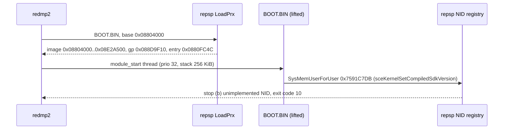

# 첫 부팅 측정 및 정적 임포트 커버리지 (`ULKS-46116`)

이 문서는 `ULKS-46116` v1.09 `BOOT.BIN`의 첫 부팅 측정 결과(issue #1 로드 단계 정지 → issue #3 `repsp v0.0.30` 고정 후 첫 런타임 정지)와 `tools/import_coverage.py`로 정적 계측한 `repsp` HLE 커버리지를 기록한다.

---

## 1. 첫 런타임 부팅 측정 결과 (`repsp v0.0.30`, `81558ef`) (**확인됨**)



### 실행 명령 및 출력 요약

```powershell
.\build\win64-release\Release\redmp2.exe roms --headless --max-vblanks 600 --save-dir <temp>\save --crash-dir <temp>\crash
```

* 식별 성공: `DJ Max Portable 2` (`ULKS46116`, v1.09, `BOOT.BIN`, 844,948 B, SHA-1 `1a5c904989d430588da9653acad4b6c5cdab2885`).
* 이미지 로드 성공: `0x08804000..0x08E2A500` (6,448,384 B), `$gp = 0x088D9F10`, `entry = 0x0880FC4C`, `module_start` 스레드(우선순위 32, 스택 256 KiB, `tid = 4`) 생성 후 게스트 실행 진입.
* 정지 보고 요약:
  * **정지 분류**: `(b) Unimplemented kernel NID`
  * **라이브러리 / NID**: `SysMemUserForUser` / `0x7591C7DB` (`sceKernelSetCompiledSdkVersion`)
  * **종료 코드**: `10`
  * **디스패치 / 프레임**: 디스패치 `0`회, 표시 `0`프레임 (`VBlank = 0`, `GE lists = 0`, `Audio output_calls = 0`)
* **로컬 CTest 상태 (**확인됨**)**: 생성 코드 포함 Release 빌드 기준 **31/32 통과, 1 실패**(`app_lift_check` 통과, `app_smoke_registered_roms`는 위 미구현 NID 정지로 실패). 생성 코드 없는 Win64 Debug/Release 빌드는 **30/30 통과** (로컬 `roms/` 포함 시 31/31).
* **issue #5 (`0007-exec-scan-code-pointers.patch`) + `repsp` #67 작업 트리(`43ac495`) 측정 (**확인됨**)**:
  * `repsp` #67의 `SysMemUserForUser` 4개 함수(`sceKernelSetCompiledSdkVersion`, `sceKernelSetCompilerVersion`, `sceKernelMaxFreeMemSize`, `sceKernelTotalFreeMemSize`)와 패치 `0007`로 `0x0880FD20`(`user_main`)이 리프트된 뒤, 헤드리스 실행(`--save-dir`/`--crash-dir` 임시 경로)은 `module_start` → `user_main` 진입 및 `UserSbrk`(598,016 B @ `0x08E2B000`) 할당까지 통과하고 다음 미구현 NID에서 정지한다:
    * **정지 분류**: `(b) Unimplemented kernel NID`
    * **라이브러리 / NID**: `ModuleMgrForUser:sceKernelGetModuleIdByAddress (0xD8B73127)`
    * **종료 코드**: `10` (디스패치 `0`, 표시 `0`프레임)
* **이전 기록 (issue #1, `repsp` `7f856eb`)**: `ET_EXEC` 미지원으로 `LoadPrx failed: Unsupported ELF type (expected PRX e_type 0xFFA0)`(종료 코드 `1`, CTest 30/32)에서 정지했으나, `repsp v0.0.30`([reexec/repsp#65](https://github.com/reexec/repsp/issues/65))의 `ET_EXEC` 로드 지원으로 해소되었다.
* 참고: `redmp2` CLI는 `<game_directory>`를 첫 번째 위치 인자(`argv[1]`)로 받는다.

---

## 2. 정적 임포트 커버리지 (`tools/import_coverage.py`) (**확인됨**)

실행 명령: `python -I tools/import_coverage.py roms/PSP_GAME/SYSDIR/BOOT.BIN` (기준 `third_party/repsp` v0.0.30 `81558ef` — HLE NID 목록은 `7f856eb`과 동일: 등록 HLE NID `146`개, 공개 이름표 `216`개).

정적 대조에서 확인된 미구현 NID 88개 중 **실제 런타임에 첫 번째로 호출된 NID**는 `SysMemUserForUser`의 `0x7591C7DB`(`sceKernelSetCompiledSdkVersion`)이다(**확인됨**).

### 라이브러리별 구현/미구현 현황

| 라이브러리 | 전체 | 구현 (`repsp`) | 미구현 |
|---|---:|---:|---:|
| `IoFileMgrForUser` | 24 | 11 | 13 |
| `Kernel_Library` | 2 | 2 | 0 |
| `LoadExecForUser` | 2 | 2 | 0 |
| `ModuleMgrForUser` | 5 | 2 | 3 |
| `StdioForUser` | 3 | 3 | 0 |
| `SysMemUserForUser` | 8 | 3 | 5 |
| `ThreadManForUser` | 33 | 27 | 6 |
| `UtilsForUser` | 7 | 4 | 3 |
| `sceSuspendForUser` | 5 | 1 | 4 |
| `sceGe_user` | 10 | 8 | 2 |
| `sceDisplay` | 6 | 6 | 0 |
| `sceCtrl` | 3 | 3 | 0 |
| `sceUmdUser` | 9 | 6 | 3 |
| `sceAudio` | 9 | 6 | 3 |
| `scePower` | 1 | 1 | 0 |
| `sceUtility` | 17 | 8 | 9 |
| `sceDmac` | 1 | 1 | 0 |
| `sceSasCore` | 21 | 13 | 8 |
| `sceMpeg` | 24 | 24 | 0 |
| `sceImpose` | 2 | 0 | 2 |
| `sceHprm` | 2 | 0 | 2 |
| `sceAtrac3plus` | 11 | 10 | 1 |
| `sceNetAdhoc` | 6 | 0 | 6 |
| `sceNetAdhocctl` | 4 | 0 | 4 |
| `sceNet` | 4 | 0 | 4 |
| `sceNetAdhocMatching` | 9 | 0 | 9 |
| `sceRtc` | 1 | 0 | 1 |
| **합계 (27개 라이브러리)** | **229** | **141 (61.6%)** | **88 (38.4%)** |

*(고유 NID 229개 중 141개 구현, 88개 미구현)*

### 미구현 NID 목록 (88개)

이름이 표기된 항목은 `third_party/repsp/src/runtime/nid_names.cpp` 공개 이름표와 일치한 것이고, `(unknown)`은 해당 이름표에 아직 없는 NID다.

* **`IoFileMgrForUser` (13)**: `0x06A70004` (`sceIoMkdir`), `0x54F5FB11`, `0x55F4717D` (`sceIoChdir`), `0x63632449`, `0x779103A0`, `0xACE946E8` (`sceIoGetstat`), `0xB29DDF9C` (`sceIoDopen`), `0xB8A740F4`, `0xE3EB004C` (`sceIoDread`), `0xEB092469` (`sceIoDclose`), `0xF27A9C51`, `0xFF5940B6` (`sceIoCloseAsync`), `0x1117C65F`
* **`ModuleMgrForUser` (3)**: `0xD8B73127`, `0xF0A26395`, `0x8F2DF740`
* **`SysMemUserForUser` (5)**: `0x13A5ABEF` (`sceKernelPrintf`), `0x7591C7DB`, `0xA291F107` (`sceKernelMaxFreeMemSize`), `0xF77D77CB`, `0xF919F628` (`sceKernelTotalFreeMemSize`)
* **`ThreadManForUser` (6)**: `0xDB738F35`, `0x56C039B5`, `0x89B3D48C`, `0xB736E9FF`, `0xBA6B92E2`, `0xBED27435`
* **`UtilsForUser` (3)**: `0x71EC4271`, `0x91E4F6A7`, `0x27CC57F0`
* **`sceSuspendForUser` (4)**: `0x3AEE7261` (`sceKernelPowerUnlock`), `0xA14F40B2`, `0xA569E425`, `0xEADB1BD7` (`sceKernelPowerLock`)
* **`sceGe_user` (2)**: `0x4C06E472` (`sceGeContinue`), `0xB448EC0D` (`sceGeBreak`)
* **`sceUmdUser` (3)**: `0x46EBB729` (`sceUmdCheckMedium`), `0x87533940`, `0xCBE9F02A`
* **`sceAudio` (3)**: `0x95FD0C2D` (`sceAudioChangeChannelConfig`), `0xB7E1D8E7` (`sceAudioChangeChannelVolume`), `0xE2D56B2D` (`sceAudioOutputPanned`)
* **`sceUtility` (9)**: `0x1579A159`, `0x4DB1E739`, `0x6332AA39`, `0x64D50C56`, `0x91E70E35`, `0xA5DA2406` (`sceUtilityGetSystemParamInt`), `0xC629AF26`, `0xF7D8D092`, `0xF88155F6`
* **`sceSasCore` (8)**: `0x267A6DD2`, `0x2C8E6AB3`, `0x50A14DFC`, `0x5F9529F6`, `0x74AE582A`, `0x787D04D5`, `0x9EC3676A`, `0xB7660A23`
* **`sceImpose` (2)**: `0x36AA6E91`, `0x72189C48`
* **`sceHprm` (2)**: `0x2BCEC83E`, `0x40D2F9F0`
* **`sceAtrac3plus` (1)**: `0x2DD3E298`
* **`sceNetAdhoc` (6)**: `0x6F92741B`, `0x7F27BB5E`, `0xA62C6F57`, `0xABED3790`, `0xDFE53E03`, `0xE1D621D7`
* **`sceNetAdhocctl` (4)**: `0x20B317A0`, `0x6402490B`, `0x9D689E13`, `0xE26F226E`
* **`sceNet` (4)**: `0x0BF0A3AE`, `0x281928A9`, `0x39AF39A6`, `0x89360950`
* **`sceNetAdhocMatching` (9)**: `0x2A2A1E07`, `0x32B156B3`, `0x5E3D4B79`, `0x7945ECDA`, `0x93EF3843`, `0xB58E61B7`, `0xCA5EDA6F`, `0xEA3C6108`, `0xF16EAF4F`
* **`sceRtc` (1)**: `0xE7C27D1B` (`sceRtcGetCurrentClockLocalTime`)

---

## 3. 추정 및 미확정 항목

* **추정**: `sceUtility` 미구현 9건 중에는 펌웨어 AV/네트워크 모듈 로드 함수(`sceUtilityLoadAvModule` / `sceUtilityUnloadAvModule` / `sceUtilityLoadNetModule` / `sceUtilityUnloadNetModule`)가 포함되어 있을 가능성이 높다(디스크에 `USRDIR/modules/*.prx`가 없기 때문).
* **미확정**: `0x7591C7DB`(`sceKernelSetCompiledSdkVersion`) 이후 부팅·타이틀·플레이 경로에서 추가로 호출되는 미구현 NID의 정확한 순서는 `repsp`에 해당 HLE를 추가하며 순차 측정으로 확정한다.

---

# First Boot Measurement and Static Import Coverage (`ULKS-46116`)

## 1. First Runtime Boot Measurement (`repsp v0.0.30`, `81558ef`) (**confirmed**)

With `third_party/repsp` pinned to v0.0.30 (`81558ef`, [reexec/repsp#65](https://github.com/reexec/repsp/issues/65)), `BOOT.BIN` now loads cleanly as a fixed-address `ET_EXEC` at `0x08804000..0x08E2A500` (`$gp = 0x088D9F10`, `entry = 0x0880FC4C`), lifting the earlier issue #1 load-stage stop (`Unsupported ELF type`).

Running `redmp2.exe roms --headless --max-vblanks 600 --save-dir <temp>\save --crash-dir <temp>\crash` enters `module_start` (prio 32, 256 KiB stack) and stops immediately on its first import call:
* **Stop class**: `(b) Unimplemented kernel NID`
* **Library / NID**: `SysMemUserForUser` / `0x7591C7DB` (`sceKernelSetCompiledSdkVersion`)
* **Exit code**: `10`
* **Counters**: `0` dispatches, `0` frames presented (`VBlank = 0`, `GE lists = 0`, `Audio output_calls = 0`).
* **Local CTest (**confirmed**)**: Release with generated code passes **31/32** (`app_lift_check` now passes; `app_smoke_registered_roms` fails on this unimplemented NID and is kept enabled). Win64 Debug/Release without generated code pass **30/30** (31/31 locally when `roms/` is present).
* **Issue #5 (`0007-exec-scan-code-pointers.patch`) with `repsp` #67 working tree (`43ac495`, **confirmed**)**: Once `0x0880FD20` (`user_main`) is lifted alongside `repsp` #67's `SysMemUserForUser` additions, the headless run enters `user_main`, allocates `UserSbrk` (598,016 B at `0x08E2B000`), and advances to the next unimplemented NID: `(b) Unimplemented kernel NID`, `ModuleMgrForUser:sceKernelGetModuleIdByAddress (0xD8B73127)`, exit code `10` (`0` dispatches, `0` frames).

## 2. Static Import Coverage (`tools/import_coverage.py`, **confirmed**)

Running `python -I tools/import_coverage.py roms/PSP_GAME/SYSDIR/BOOT.BIN` against `third_party/repsp` v0.0.30 (`81558ef`, 146 registered HLE NIDs) shows **141 / 229 (61.6%)** imported NIDs already implemented and **88 / 229 (38.4%)** missing across 19 libraries (see table and full NID list above). Of those 88 missing NIDs, the first one actually invoked at runtime is `SysMemUserForUser` `0x7591C7DB` (`sceKernelSetCompiledSdkVersion`) (**confirmed**).

## 3. Inferred and Unresolved

* **Inferred**: The 9 missing `sceUtility` NIDs include firmware AV/Net module loaders (`sceUtilityLoadAvModule` / `sceUtilityLoadNetModule`), consistent with the absence of `USRDIR/modules/*.prx`.
* **Unresolved**: The exact sequence of remaining missing NIDs invoked after `0x7591C7DB` during boot and gameplay will be confirmed incrementally as `repsp` HLE support expands.
