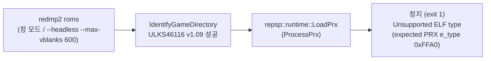

# 첫 부팅 측정 및 정적 임포트 커버리지 (`ULKS-46116`)

이 문서는 issue #1 단계 C의 첫 부팅 측정 결과(헤드리스·창 모드)와, 로드 단계 정지 이후 `tools/import_coverage.py`로 정적 계측한 `repsp` HLE 커버리지를 기록한다.

---

## 1. 첫 부팅 측정 결과 (**확인됨**)



### 실행 명령 및 출력

1. 헤드리스(`.\build\win64-release\Release\redmp2.exe roms --headless --max-vblanks 600`):
   ```text
   [redmp2] Game identified successfully:
     Title:       DJ Max Portable 2
     Disc ID:     ULKS46116
     Version:     1.09
     Executable:  BOOT.BIN (844948 bytes)
     SHA-1:       1a5c904989d430588da9653acad4b6c5cdab2885
   [boot] Error: LoadPrx failed: Unsupported ELF type (expected PRX e_type 0xFFA0)
   ```
   종료 코드: `1`.
2. 창 모드(`.\build\win64-release\Release\redmp2.exe roms`):
   동일한 출력 후 즉시 종료(종료 코드 `1`). 창 생성·게스트 진입 전 단계에서 정지.
3. 참고: `redmp2` CLI는 `<game_directory>`를 첫 번째 위치 인자(`argv[1]`)로 받으므로 `--headless`를 먼저 넘기면 `Game directory does not exist or is not a directory: --headless`로 거부된다.

### 정지 요약

* **정지 위치**: 게스트 코드 실행 진입 전 (`repsp::runtime::LoadPrx` → `repsp::module::ProcessPrx`).
* **정지 원인 (**확인됨**)**: `BOOT.BIN`이 `ET_EXEC`(`e_type = 2`)이나 `third_party/repsp` (`7f856eb`)의 `ProcessPrx`는 `e_type == 0xFFA0`(PRX)만 허용한다.
* **첫 화면 여부**: 표시되지 않음(로드 단계에서 정지).
* **호출된 미구현 import**: 0건(게스트 진입 전 정지).
* **로컬 CTest 상태 (**확인됨**)**: 생성 코드 포함 빌드 기준 **30/32 통과, 2 실패**(`app_smoke_registered_roms`, `app_lift_check` — 두 테스트 모두 동일한 `LoadPrx failed: Unsupported ELF type (expected PRX e_type 0xFFA0)`로 실패). 이 두 테스트는 비활성화하거나 `WILL_FAIL`로 숨기지 않고 그대로 두어 `repsp`의 `ET_EXEC` 로드 구현 시 자동으로 통과 여부를 검증한다.

---

## 2. 정적 임포트 커버리지 (`tools/import_coverage.py`) (**확인됨**)

실행 명령: `python -I tools/import_coverage.py roms/PSP_GAME/SYSDIR/BOOT.BIN` (기준 `third_party/repsp` `7f856eb`, 등록 HLE NID `146`개, 공개 이름표 `216`개).

### 라이브러리별 구현/미구현 현황

| 라이브러리 | 전체 | 구현 (`repsp`) | 미구현 |
|---|---:|---:|---:|
| `IoFileMgrForUser` | 24 | 11 | 13 |
| `Kernel_Library` | 2 | 2 | 0 |
| `LoadExecForUser` | 2 | 2 | 0 |
| `ModuleMgrForUser` | 5 | 2 | 3 |
| `StdioForUser` | 3 | 3 | 0 |
| `SysMemUserForUser` | 8 | 3 | 5 |
| `ThreadManForUser` | 33 | 27 | 6 |
| `UtilsForUser` | 7 | 4 | 3 |
| `sceSuspendForUser` | 5 | 1 | 4 |
| `sceGe_user` | 10 | 8 | 2 |
| `sceDisplay` | 6 | 6 | 0 |
| `sceCtrl` | 3 | 3 | 0 |
| `sceUmdUser` | 9 | 6 | 3 |
| `sceAudio` | 9 | 6 | 3 |
| `scePower` | 1 | 1 | 0 |
| `sceUtility` | 17 | 8 | 9 |
| `sceDmac` | 1 | 1 | 0 |
| `sceSasCore` | 21 | 13 | 8 |
| `sceMpeg` | 24 | 24 | 0 |
| `sceImpose` | 2 | 0 | 2 |
| `sceHprm` | 2 | 0 | 2 |
| `sceAtrac3plus` | 11 | 10 | 1 |
| `sceNetAdhoc` | 6 | 0 | 6 |
| `sceNetAdhocctl` | 4 | 0 | 4 |
| `sceNet` | 4 | 0 | 4 |
| `sceNetAdhocMatching` | 9 | 0 | 9 |
| `sceRtc` | 1 | 0 | 1 |
| **합계 (27개 라이브러리)** | **229** | **141 (61.6%)** | **88 (38.4%)** |

*(고유 NID 229개 중 141개 구현, 88개 미구현)*

### 미구현 NID 목록 (88개)

이름이 표기된 항목은 `third_party/repsp/src/runtime/nid_names.cpp` 공개 이름표와 일치한 것이고, `(unknown)`은 해당 이름표에 아직 없는 NID다.

* **`IoFileMgrForUser` (13)**: `0x06A70004` (`sceIoMkdir`), `0x54F5FB11`, `0x55F4717D` (`sceIoChdir`), `0x63632449`, `0x779103A0`, `0xACE946E8` (`sceIoGetstat`), `0xB29DDF9C` (`sceIoDopen`), `0xB8A740F4`, `0xE3EB004C` (`sceIoDread`), `0xEB092469` (`sceIoDclose`), `0xF27A9C51`, `0xFF5940B6` (`sceIoCloseAsync`), `0x1117C65F`
* **`ModuleMgrForUser` (3)**: `0xD8B73127`, `0xF0A26395`, `0x8F2DF740`
* **`SysMemUserForUser` (5)**: `0x13A5ABEF` (`sceKernelPrintf`), `0x7591C7DB`, `0xA291F107` (`sceKernelMaxFreeMemSize`), `0xF77D77CB`, `0xF919F628` (`sceKernelTotalFreeMemSize`)
* **`ThreadManForUser` (6)**: `0xDB738F35`, `0x56C039B5`, `0x89B3D48C`, `0xB736E9FF`, `0xBA6B92E2`, `0xBED27435`
* **`UtilsForUser` (3)**: `0x71EC4271`, `0x91E4F6A7`, `0x27CC57F0`
* **`sceSuspendForUser` (4)**: `0x3AEE7261` (`sceKernelPowerUnlock`), `0xA14F40B2`, `0xA569E425`, `0xEADB1BD7` (`sceKernelPowerLock`)
* **`sceGe_user` (2)**: `0x4C06E472` (`sceGeContinue`), `0xB448EC0D` (`sceGeBreak`)
* **`sceUmdUser` (3)**: `0x46EBB729` (`sceUmdCheckMedium`), `0x87533940`, `0xCBE9F02A`
* **`sceAudio` (3)**: `0x95FD0C2D` (`sceAudioChangeChannelConfig`), `0xB7E1D8E7` (`sceAudioChangeChannelVolume`), `0xE2D56B2D` (`sceAudioOutputPanned`)
* **`sceUtility` (9)**: `0x1579A159`, `0x4DB1E739`, `0x6332AA39`, `0x64D50C56`, `0x91E70E35`, `0xA5DA2406` (`sceUtilityGetSystemParamInt`), `0xC629AF26`, `0xF7D8D092`, `0xF88155F6`
* **`sceSasCore` (8)**: `0x267A6DD2`, `0x2C8E6AB3`, `0x50A14DFC`, `0x5F9529F6`, `0x74AE582A`, `0x787D04D5`, `0x9EC3676A`, `0xB7660A23`
* **`sceImpose` (2)**: `0x36AA6E91`, `0x72189C48`
* **`sceHprm` (2)**: `0x2BCEC83E`, `0x40D2F9F0`
* **`sceAtrac3plus` (1)**: `0x2DD3E298`
* **`sceNetAdhoc` (6)**: `0x6F92741B`, `0x7F27BB5E`, `0xA62C6F57`, `0xABED3790`, `0xDFE53E03`, `0xE1D621D7`
* **`sceNetAdhocctl` (4)**: `0x20B317A0`, `0x6402490B`, `0x9D689E13`, `0xE26F226E`
* **`sceNet` (4)**: `0x0BF0A3AE`, `0x281928A9`, `0x39AF39A6`, `0x89360950`
* **`sceNetAdhocMatching` (9)**: `0x2A2A1E07`, `0x32B156B3`, `0x5E3D4B79`, `0x7945ECDA`, `0x93EF3843`, `0xB58E61B7`, `0xCA5EDA6F`, `0xEA3C6108`, `0xF16EAF4F`
* **`sceRtc` (1)**: `0xE7C27D1B` (`sceRtcGetCurrentClockLocalTime`)

---

## 3. 추정 및 미확정 항목

* **추정**: `sceUtility` 미구현 9건 중에는 펌웨어 AV/네트워크 모듈 로드 함수(`sceUtilityLoadAvModule` / `sceUtilityUnloadAvModule` / `sceUtilityLoadNetModule` / `sceUtilityUnloadNetModule`)가 포함되어 있을 가능성이 높다(디스크에 `USRDIR/modules/*.prx`가 없기 때문).
* **미확정**: 88개 미구현 NID 중 실제 부팅·타이틀·플레이 경로에서 호출되는 NID가 무엇인지는 `repsp`의 `ET_EXEC` 로드 지원 후 런타임 측정으로 확정한다.

---

# First Boot Measurement and Static Import Coverage (`ULKS-46116`)

## 1. First Boot Measurement (**confirmed**)

Both headless (`redmp2.exe roms --headless --max-vblanks 600`) and windowed (`redmp2.exe roms`) runs identify `ULKS46116` v1.09 (`BOOT.BIN`, SHA-1 `1a5c904989d430588da9653acad4b6c5cdab2885`) and then stop immediately before guest execution with exit code `1`:
`[boot] Error: LoadPrx failed: Unsupported ELF type (expected PRX e_type 0xFFA0)`.
No window/frame is produced yet, and no guest imports are invoked yet. The two local-only CTest cases (`app_smoke_registered_roms`, `app_lift_check`) fail with the same error and are intentionally kept enabled (30/32 passed, 2 failed) until `repsp` adds `ET_EXEC` loading.

## 2. Static Import Coverage (`tools/import_coverage.py`, **confirmed**)

Running `python -I tools/import_coverage.py roms/PSP_GAME/SYSDIR/BOOT.BIN` against `third_party/repsp` (`7f856eb`, 146 registered HLE NIDs) shows **141 / 229 (61.6%)** imported NIDs already implemented and **88 / 229 (38.4%)** missing across 19 libraries (see table and full NID list above). Eight libraries (`Kernel_Library`, `LoadExecForUser`, `StdioForUser`, `sceDisplay`, `sceCtrl`, `scePower`, `sceDmac`, `sceMpeg`) are 100% covered; the largest uncovered groups are `sceNet*` (0/23 across 4 libraries), `IoFileMgrForUser` (13 missing), `sceUtility` (9 missing), and `sceSasCore` (8 missing), plus `sceHprm` (0/2), `sceImpose` (0/2), and `sceRtc` (0/1).

## 3. Inferred and Unresolved

* **Inferred**: The 9 missing `sceUtility` NIDs include firmware AV/Net module loaders (`sceUtilityLoadAvModule` / `sceUtilityLoadNetModule`), consistent with the absence of `USRDIR/modules/*.prx`.
* **Unresolved**: Which of the 88 missing NIDs are actually invoked during boot and gameplay will be measured once `repsp` supports loading `ET_EXEC`.
