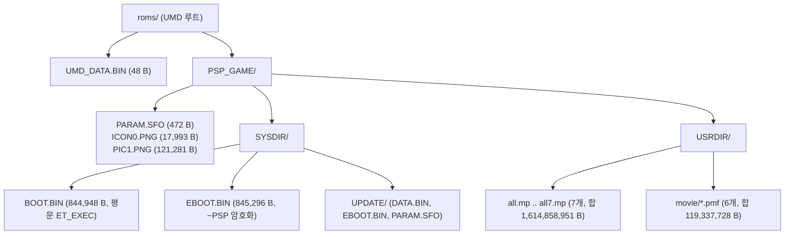

# 디스크 이미지 분석: DJ Max Portable 2 (`ULKS-46116`)

이 문서는 DJ Max Portable 2(한국판, `ULKS-46116`, 디스크 버전 1.09) 원본 UMD 이미지와 추출된 디렉터리 구성에 대해 직접 확인한 사실을 기록한다.

---

## 1. 원본 ISO 신원 (**확인됨**)

로컬 ISO 덤프는 보존 데이터베이스 [redump.org #33115](http://redump.org/disc/33115/)의 기준값과 1바이트 오차 없이 일치한다.

| 항목 | 값 | 상태 |
|---|---|---|
| redump 항목 | [redump.org #33115](http://redump.org/disc/33115/) | **확인됨** |
| 타이틀 (`PARAM.SFO` `TITLE`) | `DJ Max Portable 2` | **확인됨** |
| 시리얼 / `DISC_ID` | `ULKS-46116` (`PARAM.SFO` `DISC_ID` = `ULKS46116`) | **확인됨** |
| 디스크 버전 (`DISC_VERSION`) | `1.09` | **확인됨** |
| 필요 시스템 버전 (`PSP_SYSTEM_VER`) | `2.82` | **확인됨** |
| 카테고리 (`CATEGORY`) | `UG` (UMD Game) | **확인됨** |
| 볼륨 레이블 / PVD | `DMP2` / `2006-08-21 13:35:55 +09:00` | **확인됨** |
| 총 크기 | 1,778,319,360 바이트 (868,320 섹터) | **확인됨** |
| CRC-32 | `a5c44e0a` | **확인됨** |
| MD5 | `526d95c033a2389a722b243a6674859d` | **확인됨** |
| SHA-1 | `9018c4ab491f7314bf2bf125a3dfba2ede19529b` | **확인됨** |

---

## 2. 추출된 UMD 파일 구성 (**확인됨**)

| 경로 | 크기 (바이트) | 비고 |
|---|---:|---|
| `UMD_DATA.BIN` | 48 | UMD 메타데이터 |
| `PSP_GAME/PARAM.SFO` | 472 | `ULKS46116`, `1.09`, `2.82` |
| `PSP_GAME/ICON0.PNG` | 17,993 | XMB 아이콘 |
| `PSP_GAME/PIC1.PNG` | 121,281 | XMB 배경 |
| `PSP_GAME/SYSDIR/BOOT.BIN` | 844,948 | 평문 ELF32 MIPS LE (`ET_EXEC`), SHA-1 `1a5c904989d430588da9653acad4b6c5cdab2885` |
| `PSP_GAME/SYSDIR/EBOOT.BIN` | 845,296 | `~PSP` 암호화, SHA-1 `4157ca85a56d9e4816c2babded4a86426b1ba2b3` |
| `PSP_GAME/SYSDIR/UPDATE/DATA.BIN` | 15,456,416 | 펌웨어 업데이터 데이터 |
| `PSP_GAME/SYSDIR/UPDATE/EBOOT.BIN` | 5,079,424 | 펌웨어 업데이터 실행 파일 |
| `PSP_GAME/SYSDIR/UPDATE/PARAM.SFO` | 2,080 | 펌웨어 업데이터 SFO |
| `PSP_GAME/USRDIR/all.mp` | 364,618,668 | 자산 아카이브 |
| `PSP_GAME/USRDIR/all2.mp` | 669,578,031 | 자산 아카이브 |
| `PSP_GAME/USRDIR/all3.mp` | 348,520,431 | 자산 아카이브 |
| `PSP_GAME/USRDIR/all4.mp` | 65,300,973 | 자산 아카이브 |
| `PSP_GAME/USRDIR/all5.mp` | 166,840,007 | 자산 아카이브 |
| `PSP_GAME/USRDIR/all6.mp` | 546 | 자산 아카이브 |
| `PSP_GAME/USRDIR/all7.mp` | 295 | 자산 아카이브 |
| `PSP_GAME/USRDIR/movie/ending.pmf` | 18,804,736 | PMF 동영상 |
| `PSP_GAME/USRDIR/movie/getontop.pmf` | 19,386,368 | PMF 동영상 |
| `PSP_GAME/USRDIR/movie/nbreturns.pmf` | 19,701,760 | PMF 동영상 |
| `PSP_GAME/USRDIR/movie/ons.pmf` | 23,533,568 | PMF 동영상 |
| `PSP_GAME/USRDIR/movie/opening.pmf` | 22,771,712 | PMF 동영상 |
| `PSP_GAME/USRDIR/movie/soundstorm.pmf` | 15,136,768 | PMF 동영상 |

---

## 3. reDMP1(`ULKS-46050`)과의 차이 및 미확정 항목

* **확인됨**: `USRDIR/modules/*.prx`가 존재하지 않는다. DMP1은 `sc_sascore.prx`, `libatrac3plus.prx`, `mpeg.prx` 등을 디스크에 동봉했으나 DMP2는 펌웨어 2.82를 요구하며 디스크에 별도 PRX를 두지 않는다.
* **추정**: DMP2는 펌웨어 내장 모듈을 `sceUtilityLoadAvModule` / `sceUtilityLoadNetModule` 계열로 적재한다(`sceUtility` 미구현 NID 9건에 포함, 부팅 후 호출 시 확인).
* **미확정**: `EBOOT.BIN` 복호화 결과와 `BOOT.BIN`의 바이트 일치 여부(현재는 평문 `BOOT.BIN`을 사용하며 키 불필요). `all.mp`..`all7.mp` 내부 컨테이너 포맷.

---

# Disc Image Analysis: DJ Max Portable 2 (`ULKS-46116`)

This document records confirmed facts about the original DJ Max Portable 2 (Korea build, `ULKS-46116`, disc version 1.09) UMD image and its extracted directory layout.

## 1. Original ISO Identity (**confirmed**)

The local ISO dump matches [redump.org #33115](http://redump.org/disc/33115/) byte-for-byte: 1,778,319,360 bytes (868,320 sectors), CRC-32 `a5c44e0a`, MD5 `526d95c033a2389a722b243a6674859d`, SHA-1 `9018c4ab491f7314bf2bf125a3dfba2ede19529b`, volume `DMP2`. `PARAM.SFO` reports `DISC_ID=ULKS46116`, `DISC_VERSION=1.09`, `PSP_SYSTEM_VER=2.82`, `CATEGORY=UG`, `TITLE=DJ Max Portable 2`.

## 2. Extracted UMD Layout (**confirmed**)

See the table above. `PSP_GAME/SYSDIR/` holds plain ELF `BOOT.BIN` (844,948 bytes, SHA-1 `1a5c904989d430588da9653acad4b6c5cdab2885`) and encrypted `EBOOT.BIN` (845,296 bytes, SHA-1 `4157ca85a56d9e4816c2babded4a86426b1ba2b3`). `PSP_GAME/USRDIR/` holds seven archives (`all.mp`..`all7.mp`, ~1.61 GB total) and six PMF movies (`ending.pmf`, `getontop.pmf`, `nbreturns.pmf`, `ons.pmf`, `opening.pmf`, `soundstorm.pmf`).

## 3. Differences from reDMP1 and Open Questions

* **Confirmed**: No `USRDIR/modules/*.prx` exists on disc.
* **Inferred**: Firmware modules are loaded via `sceUtility` (`sceUtilityLoadAvModule` / `sceUtilityLoadNetModule`).
* **Unresolved**: Byte equivalence between decrypted `EBOOT.BIN` and `BOOT.BIN`; internal container format of `all.mp`..`all7.mp`.
