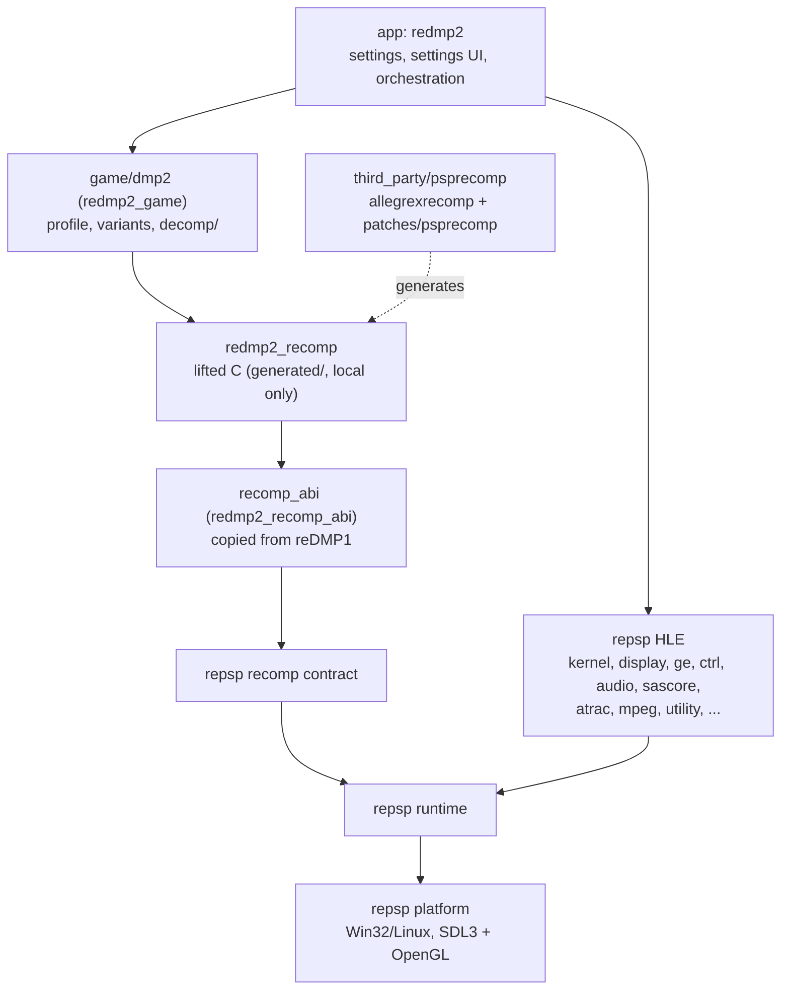

# 설계: 프로젝트 부트스트랩 — reDMP1 구조 이식, ULKS-46116 신원, lift·link·첫 부팅 측정 (issue #1)

## 1. 요구사항

* PSP 게임 DJ Max Portable 2(한국판 `ULKS-46116`, 디스크 버전 1.09, [redump.org #33115](http://redump.org/disc/33115/))를 정적 재컴파일 + 디컴파일 + HLE로 포팅하는 프로젝트를 만든다. 원격 저장소는 `reexec/reDMP2`.
* 저장소 구조, 작업 규칙, 코드는 [reexec/reDMP1](https://github.com/reexec/reDMP1)(v0.0.30, `dadb6da`)을 최대한 그대로 가져온다.
* 공유 런타임은 [reexec/repsp](https://github.com/reexec/repsp), lifter는 [sp00nznet/psprecomp](https://github.com/sp00nznet/psprecomp)다(둘 다 submodule).
* **사용자 결정(issue #1, 2026-11-21)**: psprecomp ABI 어댑터(`src/recomp_abi/`)는 reDMP1에서 이 저장소로 **복사**한다. 별도 저장소로의 분리는 두 사본의 차이가 쌓이는지 보고 나중에 정한다(**미확정**, reDMP1 i001 §3의 항목을 이어받음).
* **사용자 결정(issue #1)**: 이번 범위는 구조·규칙·문서·디스크 식별·lift에 더해 생성 코드의 link와 첫 실행에서 어디서 멈추는지의 **측정·기록**까지다. 멈춘 원인을 고치는 것은 후속 issue다.

## 2. 디스크와 실행 파일 (확인한 사실)

| 항목 | 값 | 근거 |
|---|---|---|
| ISO | 868,320 섹터, 1,778,319,360 바이트, CRC-32 `a5c44e0a`, MD5 `526d95c033a2389a722b243a6674859d`, SHA-1 `9018c4ab491f7314bf2bf125a3dfba2ede19529b` | redump #33115와 일치(**확인됨**) |
| 볼륨 레이블 / PVD | `DMP2` / 2006-08-21 13:35:55 +09:00 | redump |
| `PARAM.SFO` | `DISC_ID` `ULKS46116`, `DISC_VERSION` 1.09, `PSP_SYSTEM_VER` 2.82, `CATEGORY` `UG`, `TITLE` `DJ Max Portable 2` | 직접 파싱 |
| `BOOT.BIN` | 평문 ELF, `ET_EXEC`(2), 844,948 바이트, SHA-1 `1a5c904989d430588da9653acad4b6c5cdab2885` | 직접 파싱 |
| `EBOOT.BIN` | `~PSP` 암호화, 845,296 바이트, SHA-1 `4157ca85a56d9e4816c2babded4a86426b1ba2b3` | 직접 해시 |
| 모듈 | 이름 `djmax`, `.text` `0x08804000`..(`0xBC3D0` 바이트), entry `0x0880FC4C`, PT_LOAD 하나(vaddr `0x08804000`, filesz `0xCDF20`, memsz `0x626500`) | 직접 파싱 |
| import | 27개 라이브러리: IoFileMgr, Kernel_Library, LoadExec, ModuleMgr, Stdio, SysMem, ThreadMan, Utils, sceSuspend, sceGe_user, sceDisplay, sceCtrl, sceUmdUser, sceAudio, scePower, sceUtility, sceDmac, sceSasCore, sceMpeg, sceImpose, sceHprm, sceAtrac3plus, sceNetAdhoc, sceNetAdhocctl, sceNet, sceNetAdhocMatching, sceRtc | 직접 파싱 |
| 자산 | `USRDIR/all.mp`..`all7.mp`(합 약 1.6 GB), `USRDIR/movie/*.pmf` 6개 | 목록 |

reDMP1(DMP1)과 다른 점:

* **확인됨**: 디스크에 `USRDIR/modules/*.prx`가 **없다**. DMP1은 `sc_sascore.prx`, `libatrac3plus.prx`, `mpeg.prx` 등을 디스크에서 올렸다. **추정**: DMP2는 `sceUtilityLoadAvModule`/`sceUtilityLoadModule`(펌웨어 2.71+)로 펌웨어의 모듈을 올린다. repsp는 이 import들을 NID 경계에서 이미 HLE하므로 영향은 `sceUtility`의 모듈 로드 함수가 성공을 돌려주는지에 한정될 것으로 본다. 첫 부팅 측정에서 확인한다.
* **확인됨**: `sceNet`/`sceNetAdhoc*`(애드혹 멀티플레이)와 `sceHprm`(리모컨)이 새로 import된다. repsp에 없는 NID는 첫 부팅 측정의 정지 분류 `(b)`(미구현 import)로 드러난다. 기본 방향은 "애드혹 미지원"을 돌려주는 최소 HLE이며, 후속 issue에서 repsp에 넣는다.
* **확인됨**: 컨테이너 형식이 DMP1과 **다르다**. DMP1의 `BOOT.BIN`은 재배치 가능한 PRX(`e_type 0xFFA0`, entry `0x128`)를 `0x08804000`에 재배치해 썼지만, DMP2의 `BOOT.BIN`은 `0x08804000`에 고정된 `ET_EXEC`(`e_type 2`, entry `0x0880FC4C`, 재배치 섹션 비어 있음)다. 최종 주소는 같다.
  * repsp의 `repsp::module::ProcessPrx`(`src/module/prx.cpp`)는 `e_type 0xFFA0`만 받는다. 그래서 첫 부팅은 로드 단계에서 거부될 것으로 본다(**추정**, §5에서 측정). `ET_EXEC` 로드는 PSP 일반 기능이므로 repsp issue로 repsp에 넣는다(후속, 이 task의 범위 밖).
  * `allegrexrecomp`가 `ET_EXEC`를 lift하는지, psprecomp 패치 `0001-relocate-prx-at-base`가 `ET_EXEC`에서 아무 일도 하지 않는지는 단계 B의 lift 결과로 확인한다(**미확정**).
* `EBOOT.BIN` 복호화 결과와 `BOOT.BIN`의 바이트 일치는 reDMP1과 같이 **미확정**으로 두고 `BOOT.BIN`으로 진행한다(키 불필요).

## 3. 레이어 구조

reDMP1과 같다. 이름만 `dmp1`/`redmp1` → `dmp2`/`redmp2`로 바뀐다.

## 4. reDMP1에서 가져오는 것

| reDMP1 | reDMP2 | 처리 |
|---|---|---|
| `AGENTS.md`, `CLAUDE.md`, `GEMINI.md`, `docs/CODING_STYLE.md`, `docs/PROJECT_CHARTER.md`, `LICENSE`, `.gitattributes`, `.gitignore` | 같은 파일 | 타이틀·ID·이름 치환. 규칙 내용은 그대로 |
| `ARCHITECTURE.md`, `README.md`, `CREDITS.md`, `THIRD_PARTY_NOTICES.md` | 같은 파일 | 현재 reDMP2 상태에 맞게 다시 쓴다(autoplay 없음, 이식 출처 명시) |
| `CMakeLists.txt`, `CMakePresets.json`, `cmake/` | 같은 파일 | `REDMP1_*` → `REDMP2_*`, 타깃 `redmp2*`, autoplay 제외 |
| `src/recomp_abi/` | 같은 경로 | 복사(§1 사용자 결정). `REDMP1_` 매크로·환경 변수 접두사만 `REDMP2_`로 |
| `src/game/dmp1/`, `include/redmp1/` | `src/game/dmp2/`, `include/redmp2/` | 프로파일 이름 치환, `variants.json`은 `register_disc.py`로 새로 생성 |
| `src/game/dmp1/recomp/lift.json`, `seed_functions.json`, `CMakeLists.txt` | `src/game/dmp2/recomp/` | `prefix` `dmp2`, base는 §2의 값, `seed_functions.json`은 빈 배열에서 시작 |
| `src/app/main.cpp`, `settings.*`, `settings_ui.*`, `settings_probe.cpp` | 같은 경로 | 이름 치환. 사용자 데이터 디렉터리 `redmp2`, 설정 파일 `redmp2.ini`, 창 제목 `reDMP2` |
| `src/app/autoplay*` | **가져오지 않음** | DMP1 게임 메모리 구조에 묶인 기능. DMP2 분석 뒤 별도 issue. main/settings UI의 결합점은 제거한다 |
| `scripts/`(build, recomp, `check_lift_invariance.py`, `generate_synthetic_sfo.py`) | 같은 경로 | 이름 치환 |
| `patches/psprecomp/` | 같은 경로 | 그대로(같은 psprecomp 고정점) |
| `tools/`(`lift_audit.py`, `analyze_crash.py`, `compare_bmp.py`, `audio_gaps.py`) | 같은 경로 | 이름 치환. DMP1 주소가 하드코딩된 곳이 있으면 인자로 바꾸거나 작업 로그에 남긴다 |
| `tests/` | 같은 경로 | 이름 치환 |
| `.github/workflows/` | 같은 경로 | 이름 치환 |
| `docs/guides/` | 같은 경로 | 이름·ID·해시 치환. 아직 해당 없는 절차(예: autoplay)는 뺀다 |
| `docs/analysis/`, `docs/kb/` | 새로 시작 | `README.md` 색인, `disc-image.md`, `executable.md`, `boot.md`만. DMP1의 분석 결론은 옮기지 않는다(다른 바이너리) |
| `docs/design/`, `work-orders/`, `work-logs/`, `release-notes/` | 새로 시작 | 이 task의 문서만 |
| `docs/EXECUTABLE_DESIGN.{ko,en}.md` | 새로 시작 | §2의 사실로 시작 |

* submodule 고정점은 reDMP1과 같게 한다: `third_party/repsp` `7f856eb`(repsp v0.0.29), `third_party/psprecomp` `5ca18fa`. 같은 고정점이면 복사한 어댑터와 패치가 그대로 맞는다.
* `VERSION`은 `0.0.0`에서 시작한다(첫 머지에서 0.0.1).
* 게임 데이터 규칙: 저장소 루트의 ISO, `roms/`, 생성 코드는 `.gitignore`로 막는다.

## 5. 첫 부팅 측정

* `redmp2 roms`를 창 모드와 `--headless --max-vblanks N`으로 실행해, 정지 분류(`(a)` 정상 종료/`(b)` 미구현 import/`(c)` 디스패치 미스/`(e)` 접근 위반)와 마지막 로그, 첫 화면이 나오는지를 기록한다.
* 미구현 import 목록(호출된 것과 import만 된 것)을 `docs/analysis/boot.md`에 남긴다. 특히 `sceUtilityLoadAvModule`, `sceNet*`, `sceHprm`.
* 고치지 않는다. 결과를 바탕으로 후속 issue를 제안한다.

## 6. 검증

1. Win64 Debug/Release가 경고 없이 빌드되고, 생성 코드 없이(CI 조건) CTest가 통과한다.
2. 앱 smoke: 인자 없음, 없는 폴더, `PARAM.SFO` 없는 폴더, 등록되지 않은 `DISC_ID`를 0이 아닌 종료 코드로 거부한다.
3. 로컬: `register_disc.py roms`가 §2의 값으로 `variants.json`을 만들고 앱이 그 폴더를 식별한다.
4. 로컬: `regenerate.py`가 `generated/`를 만들고, 함수 수·진입점 수·`.text` 커버리지를 `docs/analysis/executable.md`에 남긴다. `lift_audit.py` 결과도 남긴다.
5. 로컬: 생성 코드를 포함한 빌드가 링크되고, CTest가 통과한다.
6. 로컬: §5의 첫 부팅 측정 결과가 `docs/analysis/boot.md`와 작업 로그에 있다.
7. `git status`에 게임 데이터와 생성 코드가 없다. `git grep -i -E "dmp1|redmp1"`의 결과는 출처 표기와 reDMP1 비교 설명뿐이다.

---

# Design: project bootstrap — porting the reDMP1 structure, ULKS-46116 identity, lift, link and first boot measurement (issue #1)

## 1. Requirements

* Create the project that ports the PSP game DJ Max Portable 2 (Korea build `ULKS-46116`, disc version 1.09, [redump.org #33115](http://redump.org/disc/33115/)) by static recompilation + decompilation + HLE. The remote is `reexec/reDMP2`.
* Repository structure, working rules and code are taken from [reexec/reDMP1](https://github.com/reexec/reDMP1) (v0.0.30, `dadb6da`) as far as possible.
* The shared runtime is [reexec/repsp](https://github.com/reexec/repsp); the lifter is [sp00nznet/psprecomp](https://github.com/sp00nznet/psprecomp) (both submodules).
* **User decision (issue #1, 2026-11-21)**: the psprecomp ABI adapter (`src/recomp_abi/`) is **copied** from reDMP1. Splitting it into its own repository is decided later, once it is clear whether the two copies diverge (**unresolved**, carried over from reDMP1 i001 §3).
* **User decision (issue #1)**: the scope is the structure, rules, documents, disc identity and lift, plus linking the generated code and **measuring and recording** where the first run stops. Fixing what stops it is follow-up work.

## 2. Disc and executable (confirmed facts)

See the table above. The ISO matches redump #33115 (**confirmed**). `BOOT.BIN` is a plain `ET_EXEC` ELF (module `djmax`, base `0x08804000`, entry `0x0880FC4C`, one PT_LOAD) importing 27 libraries.

Differences from reDMP1 (DMP1):

* **Confirmed**: the disc has **no** `USRDIR/modules/*.prx`. **Inferred**: DMP2 loads the firmware's modules through `sceUtilityLoadAvModule`/`sceUtilityLoadModule` (firmware 2.71+). repsp already HLEs those imports at the NID boundary, so the impact should be limited to whether the `sceUtility` module-load functions report success; the first boot measurement checks this.
* **Confirmed**: `sceNet`/`sceNetAdhoc*` (ad-hoc multiplayer) and `sceHprm` (remote) are newly imported. NIDs repsp lacks surface as stop class `(b)` (unimplemented import) in the first boot measurement. The default direction is a minimal HLE that reports ad-hoc as unavailable, added to repsp in a follow-up issue.
* **Confirmed**: the container **differs** from DMP1. DMP1's `BOOT.BIN` is a relocatable PRX (`e_type 0xFFA0`, entry `0x128`) relocated to `0x08804000`; DMP2's `BOOT.BIN` is an `ET_EXEC` fixed at `0x08804000` (`e_type 2`, entry `0x0880FC4C`, empty relocation sections). The final addresses are the same.
  * repsp's `repsp::module::ProcessPrx` (`src/module/prx.cpp`) accepts only `e_type 0xFFA0`, so the first boot is expected to be rejected at load (**inferred**, measured in §5). Loading `ET_EXEC` is general PSP functionality and goes into repsp through a repsp issue (follow-up, outside this task).
  * Whether `allegrexrecomp` lifts an `ET_EXEC`, and whether psprecomp patch `0001-relocate-prx-at-base` is a no-op for it, is checked by the phase B lift (**unresolved**).
* Byte identity of decrypted `EBOOT.BIN` and `BOOT.BIN` stays **unresolved** as in reDMP1; `BOOT.BIN` is used (no keys needed).

## 3. Layer structure

The same as reDMP1, with `dmp1`/`redmp1` renamed to `dmp2`/`redmp2` (diagram above).

## 4. What is taken from reDMP1

See the table above. In short: rules and repository files are carried over with the title, IDs and names replaced; `ARCHITECTURE.md`, `README.md`, `CREDITS.md` and `THIRD_PARTY_NOTICES.md` are rewritten for reDMP2's state; CMake, the adapter, the title layer, the app, scripts, patches, tools, tests, workflows and guides are carried over with `REDMP1_`/`redmp1`/`dmp1` renamed; **`src/app/autoplay*` is not carried over** (it is tied to DMP1's game memory; a separate issue after DMP2 analysis) and its hooks in main and the settings UI are removed; `docs/analysis/`, `docs/kb/` and the task documents start fresh (DMP1's analysis conclusions are about a different binary).

* The submodules are pinned like reDMP1: `third_party/repsp` `7f856eb` (repsp v0.0.29), `third_party/psprecomp` `5ca18fa`, so the copied adapter and patches fit as they are.
* `VERSION` starts at `0.0.0` (0.0.1 at the first merge).
* Game data: the ISO at the repository root, `roms/` and generated code are kept out by `.gitignore`.

## 5. First boot measurement

* Run `redmp2 roms` windowed and with `--headless --max-vblanks N`, and record the stop class (`(a)` clean exit, `(b)` unimplemented import, `(c)` dispatch miss, `(e)` access violation), the last log lines, and whether a first frame appears.
* Record the unimplemented imports (called, and only imported) in `docs/analysis/boot.md`, especially `sceUtilityLoadAvModule`, `sceNet*` and `sceHprm`.
* Nothing is fixed; follow-up issues are proposed from the result.

## 6. Verification

1. Win64 Debug/Release build without warnings, and CTest passes without generated code (the CI condition).
2. App smoke: no arguments, a missing folder, a folder without `PARAM.SFO` and an unregistered `DISC_ID` are rejected with a non-zero exit code.
3. Local: `register_disc.py roms` writes `variants.json` with the §2 values and the app identifies the folder.
4. Local: `regenerate.py` produces `generated/`; function count, entry count and `.text` coverage go to `docs/analysis/executable.md`, along with the `lift_audit.py` result.
5. Local: the build with generated code links and CTest passes.
6. Local: the §5 measurement is in `docs/analysis/boot.md` and the work log.
7. `git status` shows no game data or generated code. `git grep -i -E "dmp1|redmp1"` finds only attributions and comparisons with reDMP1.
