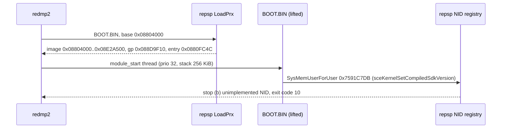

# 설계: repsp v0.0.30 고정과 첫 런타임 부팅 측정 (issue #3)

## 1. 요구사항

* [repsp v0.0.30](https://github.com/reexec/repsp/issues/65)은 고정 주소 `ET_EXEC`를 로드한다. issue #1에서 실행을 막던 `LoadPrx failed: Unsupported ELF type`이 풀린다.
* `third_party/repsp`를 v0.0.30의 머지 커밋으로 옮기고, 이제 가능해진 첫 런타임 부팅을 측정·기록한다.
* HLE 구현은 이 task의 범위가 아니다(repsp의 후속 작업). 이 저장소의 코드는 바꾸지 않는다.

## 2. 고정점

* repsp `7f856eb`(v0.0.29) → v0.0.30 머지 커밋. 공개 API의 시그니처는 바뀌지 않았으므로(`ParsePrx`, `RelocateToBuffer`, `runtime::LoadPrx`) 앱과 어댑터는 그대로 빌드되어야 한다. psprecomp 고정점은 그대로다.

## 3. 측정

issue #3 준비 중에 repsp 작업 브랜치로 미리 확인한 결과(**확인됨**, 고정점을 옮긴 뒤 다시 측정해 작업 로그에 남긴다):

* 정지는 entry 직후 첫 import 호출이다. 디스패치 0회, 표시 0프레임.
* CTest(게임 데이터 있음, 생성 코드 포함): `app_lift_check` 통과, `app_smoke_registered_roms`는 위 정지로 실패(31/32). 이 테스트는 계속 그대로 둔다. 부팅 경로의 HLE가 채워지면 통과한다.

## 4. 문서

* `docs/analysis/boot.md`: 정지 위치가 로드 → 첫 미구현 NID로 바뀐 것, 측정 명령과 출력 요약. 정적 import 대조(issue #1)의 88개 중 첫 번째로 실제 호출된 것이 `sceKernelSetCompiledSdkVersion`이라는 사실(**확인됨**).
* `ARCHITECTURE.md`, `README.md`, `docs/guides/`: repsp 고정점이나 "로드에서 멈춘다"는 설명이 있으면 갱신한다.
* 작업 로그.

## 5. 검증

1. 생성 코드 없이 Win64 Debug/Release 빌드, CTest 30/30(CI 조건).
2. 생성 코드 포함 Release 빌드, CTest 31/32(위 §3).
3. `redmp2 roms --headless --max-vblanks 600 --save-dir <임시> --crash-dir <임시>`의 정지 보고가 §3과 같다.

---

# Design: pin repsp v0.0.30 and measure the first runtime boot (issue #3)

## 1. Requirements

* [repsp v0.0.30](https://github.com/reexec/repsp/issues/65) loads fixed-address `ET_EXEC` executables, lifting the `LoadPrx failed: Unsupported ELF type` stop from issue #1.
* Move `third_party/repsp` to v0.0.30's merge commit and measure and record the first runtime boot this makes possible.
* HLE implementation is out of scope (repsp follow-up work); no code in this repository changes.

## 2. Pin

* repsp `7f856eb` (v0.0.29) → the v0.0.30 merge commit. The public API signatures did not change (`ParsePrx`, `RelocateToBuffer`, `runtime::LoadPrx`), so the app and the adapter should build as they are. The psprecomp pin stays.

## 3. Measurement

Measured in advance with the repsp task branch while preparing issue #3 (**confirmed**; re-measured after the pin moves and recorded in the work log). See the sequence diagram above: the image loads at `0x08804000..0x08E2A500` with gp `0x088D9F10` and entry `0x0880FC4C`; the `module_start` thread's first import call, `SysMemUserForUser` `0x7591C7DB` (`sceKernelSetCompiledSdkVersion`), stops with class (b), unimplemented NID, exit code 10. No dispatches, no frames presented.

* CTest (with game data and generated code): `app_lift_check` passes; `app_smoke_registered_roms` fails on that stop (31/32). The test stays as it is and passes once the boot path's HLE is filled in.

## 4. Documents

* `docs/analysis/boot.md`: the stop moved from load to the first unimplemented NID, with the command and output summary; of the 88 NIDs from issue #1's static import coverage, the first actually called is `sceKernelSetCompiledSdkVersion` (**confirmed**).
* `ARCHITECTURE.md`, `README.md`, `docs/guides/`: update any mention of the repsp pin or of the run stopping at load.
* The work log.

## 5. Verification

1. Win64 Debug/Release without generated code, CTest 30/30 (the CI condition).
2. Release with generated code, CTest 31/32 (§3 above).
3. The stop report of `redmp2 roms --headless --max-vblanks 600 --save-dir <temp> --crash-dir <temp>` matches §3.
