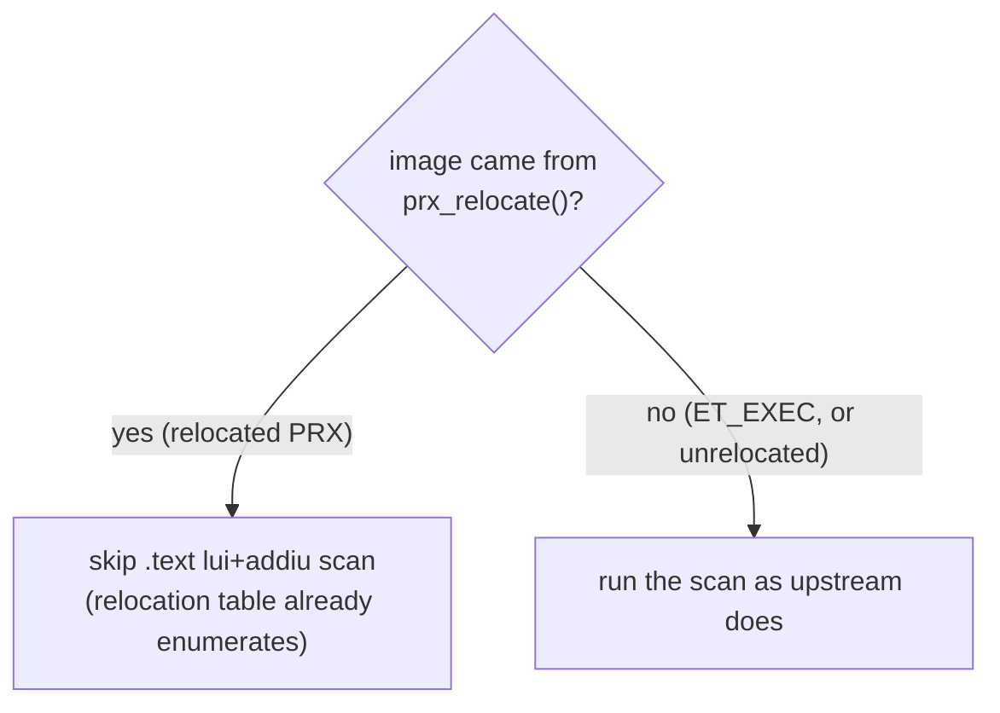

# 설계: `ET_EXEC`에서 코드가 조립하는 함수 포인터 찾기 (issue #5)

## 1. 문제

* repsp #67의 부팅 경로 HLE로 `module_start`가 `sceKernelCreateThread`까지 가고, 새 스레드의 진입점 `0x0880FD20`에서 디스패치 미스로 멈춘다(**확인됨**).
* 그 주소는 `.text`에서 `0x0880FC84 lui $v0, 0x881` / `0x0880FC94 addiu $a1, $v0, -736`으로 만들어져 `$a1`(진입점 인자)로 넘어간다. lift된 함수가 아니다(**확인됨**, 생성 코드 `dmp2_funcs_007.c`).
* 원인: 로컬 패치 `0001-relocate-prx-at-base.patch`가 `a_discover`의 `.text` lui+addiu 쌍 스캔을 "image가 있으면" 건너뛰게 했다(`if (an->scan_calls && !an->image)`). 재배치한 PRX에서는 맞다. 재배치 표(HI16/LO16)가 그 쌍을 모두 알려 주기 때문이다. 그런데 `ET_EXEC`도 세그먼트 0을 image로 받고(`main.c`, 점프 테이블 읽기용) 재배치 표는 비어 있다. 그래서 코드가 조립하는 함수 포인터(스레드 진입점, 콜백, 함수 표의 주소)를 하나도 찾지 못한다(**확인됨**, 코드 읽기). upstream `5ca18fa`는 이 스캔을 조건 없이 한다.

## 2. 수정

* 새 로컬 패치 `patches/psprecomp/0007-exec-scan-code-pointers.patch`: `a_analysis`에 "image가 재배치 결과인가"를 나타내는 값을 두고(예: `image_relocated`), `main.c`가 `reloc_buf`를 image로 줄 때만 세운다. `analyze.c`의 조건을 `an->scan_calls && !an->image_relocated`로 바꾼다. 재배치하지 않은 PRX(base 0)는 패치 `0001`의 주석대로 작은 즉치값이 `.text`와 겹치는 문제가 있으나, 그 경우는 `image`가 없는(=지금 동작 그대로) 경로가 아니므로 따로 살핀다: 재배치하지 않은 PRX도 image를 받는다면 그 경우는 스캔하지 않는 지금 동작을 유지한다. 즉 스캔은 "`ET_EXEC`이거나 image가 없을 때"만 한다. 판단 근거는 `e_type`(컨테이너가 이미 안다)으로 한다.
* `0001`을 직접 고치지 않고 새 패치로 둔다. `0001`은 upstream PR #36과 같은 커밋이라는 기록(README)을 지키기 위해서다. upstream에 반영하는 것은 별도 결정이다(§4).
* PRX 경로는 바뀌지 않는다. reDMP1(PRX)의 lift 결과도 바뀌지 않아야 한다.

## 3. 영향과 측정

* 다시 lift하면 함수 수와 진입점 수가 늘어날 것이다(**추정**). 늘어난 것 중 데이터를 코드로 잘못 읽은 것이 없는지 `tools/lift_audit.py`의 "Data misread as code"로 확인한다. lui+addiu 스캔은 "주소가 범위 안이고 유효한 코드로 해석되면 진입점"으로 보는 과분할 허용 휴리스틱이다(upstream 주석). 과분할은 안전하다(진입점이 더 생길 뿐 동작은 같음).
* 확인: `0x0880FD20`이 lift되고, 부팅 실행이 그 디스패치 미스를 지나간다. 다음 정지 지점을 기록한다(repsp #67의 반복으로 이어짐).

## 4. upstream

* 같은 버그가 [sp00nznet/psprecomp#36](https://github.com/sp00nznet/psprecomp/pull/36)에 있다. PR을 고치는 것은 외부 저장소 작업이라 사용자 결정이다(**미확정**). 결정 전까지 README의 upstream 표에 "#36에 반영 필요"로 적는다.

## 5. 검증

1. 생성 코드 없이 Win64 Debug/Release 빌드, CTest(CI 조건).
2. `regenerate.py` 후 함수 수·내부 진입점·`.text` 커버리지·점프 테이블·`lift_audit.py` 결과를 issue #1의 값과 비교한다.
3. 생성 코드 포함 Release 빌드와 CTest, 헤드리스 실행(`--save-dir`/`--crash-dir`는 저장소 밖). 실행에 쓰는 repsp는 현재 submodule 작업 트리(repsp #67 브랜치)다. 그 사실을 작업 로그에 적는다.
4. reDMP1의 `BOOT.BIN`(PRX)에 같은 도구로 `funcs`를 돌려 함수 수가 패치 전과 같은지 확인한다(읽기만, reDMP1 파일은 바꾸지 않음).

## 6. 후속: `.text` 밖에서 발견된 함수 안의 포인터 (issue #5 후속, repsp #67에서 발견)

* 패치 `0007` 뒤 부팅은 `0x088832B8`에서 디스패치 미스로 멈춘다(**확인됨**). 그 주소는 C++ 정적 초기화 함수 `0x088D0BB8`이 `lui $a1, 0x888` / `addiu $a1, $a1, 12984`로 만들어 배열 생성 도우미(`jal 0x0880410C`)에 원소 생성자로 넘긴다. 소멸자 `0x08883278`도 같은 방식이다.
* `0x088D0BB8`은 섹션 헤더로는 `.data`(`0x088C1978..0x088D1F20`) 안에 있다. 다른 경로로 발견되어 lift됐지만, lui+addiu 스캔은 `[scan_base, scan_base + scan_size)`(=`.text`)만 선형으로 훑으므로 그 본문 안의 쌍을 보지 못한다(**확인됨**, coder 분석과 생성 코드 `dmp2_funcs_125.c`).
* 수정(패치 `0008`, 또는 `0007`에 더함): `a_discover`의 고정점 반복에서 매 바퀴 끝에, 이미 발견된 함수 중 `.text` 밖에 있는 것의 **본문 명령만** lui+addiu 쌍으로 스캔해 새 진입점을 더한다. 새 진입점이 없으면 반복이 끝난다(기존 8바퀴 상한 유지). `.data` 전체를 선형으로 훑지 않는다. 데이터 워드를 명령으로 잘못 읽을 위험이 크기 때문이다. 대상은 `0007`과 같이 `skip_lui_scan`이 0인 경우(`ET_EXEC`)로 한정한다.
* 측정과 검증은 §3·§5와 같다. 추가로 `0x088832B8`과 `0x08883278`이 lift되는지, `lift_audit.py`의 "Data misread as code"가 0인지 확인한다.

---

# Design: finding code-built function pointers in an `ET_EXEC` (issue #5)

## 1. Problem

* With repsp #67's boot-path HLE, `module_start` reaches `sceKernelCreateThread` and the run stops with a dispatch miss at the new thread's entry `0x0880FD20` (**confirmed**).
* That address is built in `.text` by `0x0880FC84 lui $v0, 0x881` / `0x0880FC94 addiu $a1, $v0, -736` and passed in `$a1` (the entry argument). It is not a lifted function (**confirmed**, generated `dmp2_funcs_007.c`).
* Cause: local patch `0001-relocate-prx-at-base.patch` made `a_discover` skip the `.text` lui+addiu pair scan whenever an image is present (`if (an->scan_calls && !an->image)`). That is right for a relocated PRX, whose relocation table (HI16/LO16) enumerates those pairs. But an `ET_EXEC` also gets segment 0 as its image (`main.c`, for reading jump tables) and has an empty relocation table, so no code-built function pointer (thread entries, callbacks, addresses in function tables) is found (**confirmed**, by reading the code). Upstream `5ca18fa` runs the scan unconditionally.

## 2. Fix

See the diagram above.

* A new local patch `patches/psprecomp/0007-exec-scan-code-pointers.patch`: `a_analysis` gets a flag saying the image is a relocation result (for example `image_relocated`), set by `main.c` only when it hands `reloc_buf` over as the image; `analyze.c`'s condition becomes `an->scan_calls && !an->image_relocated`. An unrelocated PRX (base 0) has the problem patch `0001`'s comment describes (small immediates colliding with `.text`); if it also gets an image, it keeps today's no-scan behaviour. So the scan runs only "for an `ET_EXEC`, or when there is no image", decided from `e_type`, which the container already knows.
* `0001` is not edited; the fix is a new patch, keeping the README's record that `0001` equals upstream PR #36's commit. Taking it upstream is a separate decision (§4).
* The PRX path does not change, and reDMP1's (PRX) lift result must not change either.

## 3. Impact and measurement

* A new lift should find more functions and entries (**inferred**). The `lift_audit.py` "Data misread as code" count checks that none of the new ones is data read as code. The lui+addiu scan is an over-split-is-safe heuristic ("an address in range that decodes as valid code is an entry", upstream comment): over-splitting only adds entries, behaviour is the same.
* Confirm that `0x0880FD20` is lifted and the boot run gets past that dispatch miss; record the next stop (continued by repsp #67's loop).

## 4. Upstream

* The same bug is in [sp00nznet/psprecomp#36](https://github.com/sp00nznet/psprecomp/pull/36). Fixing that PR is work in an outside repository and the user's decision (**unresolved**). Until then the README's upstream table says "needs to go into #36".

## 5. Verification

1. Win64 Debug/Release without generated code, CTest (the CI condition).
2. After `regenerate.py`, compare functions, internal entries, `.text` coverage, jump tables and the `lift_audit.py` result with issue #1's values.
3. Release with generated code, CTest and the headless run (`--save-dir`/`--crash-dir` outside the repository). The repsp used is the current submodule working tree (the repsp #67 branch); the work log says so.
4. Run the same tool's `funcs` on reDMP1's `BOOT.BIN` (a PRX) and check the function count is unchanged (read only; no reDMP1 file changes).

## 6. Follow-up: pointers inside functions found outside `.text` (issue #5 follow-up, found in repsp #67)

* After patch `0007` the boot stops with a dispatch miss at `0x088832B8` (**confirmed**). That address is built by the C++ static initializer `0x088D0BB8` (`lui $a1, 0x888` / `addiu $a1, $a1, 12984`) and passed to an array-construction helper (`jal 0x0880410C`) as the element constructor; the destructor `0x08883278` is built the same way.
* By its section headers `0x088D0BB8` lies inside `.data` (`0x088C1978..0x088D1F20`). It is found and lifted through other seeds, but the lui+addiu scan walks only `[scan_base, scan_base + scan_size)` (that is, `.text`) linearly, so pairs inside its body are never seen (**confirmed**, the coder's analysis and generated `dmp2_funcs_125.c`).
* Fix (patch `0008`, or folded into `0007`): at the end of each round of `a_discover`'s fixpoint loop, scan **only the body instructions** of already discovered functions that lie outside `.text` for lui+addiu pairs and add the new entries; the loop ends when no entry is added (the existing cap of 8 rounds stays). `.data` is not scanned linearly, because data words read as instructions are too likely. Limited, like `0007`, to `skip_lui_scan == 0` (`ET_EXEC`).
* Measurement and verification as in §3 and §5, plus: `0x088832B8` and `0x08883278` are lifted and `lift_audit.py`'s "Data misread as code" stays 0.
