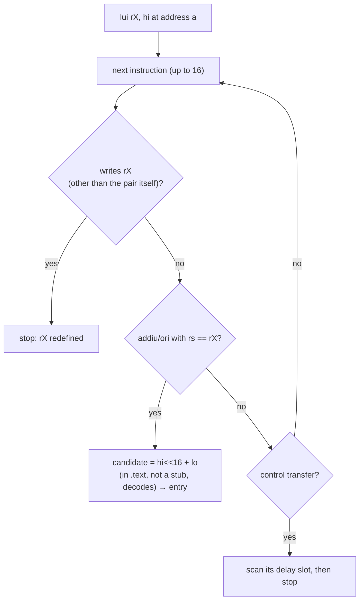

# 설계: 타이틀 화면까지 (issue #9)

## 1. 요구사항

* 오프닝 영상을 건너뛰고 첫 입력 대기 화면(타이틀)까지 간다. HLE는 repsp [#71](https://github.com/reexec/repsp/issues/71)에서, lift 쪽 결함은 이 저장소에서 고친다. 끝나면 repsp 고정점을 옮기고 타이틀 화면을 기록한다.
* 실행: `--input-script`(영상 건너뛰기)와 `--codec-plugin`(로컬 LGPL 플러그인 빌드, 커밋하지 않음).

## 2. lift 누락: lui와 addiu 사이가 먼 포인터 (확인됨)

* repsp #71의 첫 반복(`sceIoCloseAsync`) 뒤, 부팅은 `0x08817218`에서 디스패치 미스로 멈춘다. 그 주소는 할당 콜백 함수(`mult` / `mflo` / `j 0x0887FF0C`)이고, 해제 콜백 `0x08817228`과 짝으로 세 곳(`0x088173A4`, `0x08817648`, `0x088179A8`)에서 레지스터로 조립되어 `jal 0x088BC778`에 넘겨진다.
  ```
  088173A4  lui    $t0, 0x881
  088173A8  lui    $t1, 0x881
  088173AC  addu   $a0, $s3, $zero
  088173B0  addiu  $a2, $v0, 4
  088173B4  addiu  $a1, $sp, 40
  088173B8  addiu  $t0, $t0, 29208   ; 0x08817218, lui 뒤 5번째
  088173BC  jal    0x088BC778
  088173C0  addiu  $t1, $t1, 29224   ; 0x08817228, lui 뒤 6번째 (지연 슬롯)
  ```
* 원인: lui+addiu 쌍 스캔(upstream `analyze.c`의 `.text` 스캔과 로컬 패치 `0008`)이 lui 뒤 4개 명령까지만 짝을 찾는다. 컴파일러가 두 lui와 인자 준비를 섞어 배치하면 놓친다.

## 3. 수정 (패치 `0011`)



* 고정 창(4) 대신 **레지스터 추적**: lui가 쓴 `rX`를 다른 명령이 다시 쓰거나, 분기·점프(그 지연 슬롯까지 본 뒤)가 나오거나, 16개 명령에 닿으면 멈춘다. 그 사이에 `rs == rX`인 addiu/ori가 있으면 짝으로 본다. 한 lui가 여러 addiu와 짝일 수 있으므로(`rt != rX`인 addiu), 멈출 때까지 모두 본다.
* 후보 주소의 조건은 지금과 같다: `.text` 안, import stub이 아님, 유효한 명령으로 해석됨.
* `.text` 스캔과 `0008`의 `.text` 밖 본문 스캔이 같은 함수를 쓴다. 대상은 `skip_lui_scan == 0`(`ET_EXEC`)로 한정한다. PRX 경로는 바뀌지 않는다.
* 과분할은 안전하다(진입점이 늘 뿐). 잘못된 짝(다른 값)을 막는 것이 레지스터 추적의 목적이다.

## 4. 검증

1. `0x08817218`, `0x08817228`이 lift되고, 부팅이 그 디스패치 미스를 지난다.
2. 함수 수·진입점·커버리지·`lift_audit.py`(데이터 오독 0, 불일치 0)를 v0.0.4 값과 비교한다. reDMP1(PRX) 결과가 바뀌지 않는다.
3. 생성 코드 없이 CTest 30/30, 생성 코드 포함 32/32.
4. 이후 repsp #71의 반복이 이어지고, 타이틀 화면에 닿으면 그 프레임을 작업 로그에 기록한다(덤프는 커밋하지 않음).

---

# Design: up to the title screen (issue #9)

## 1. Requirements

* Skip the opening movie and reach the first screen that waits for input (the title). HLE is done in repsp [#71](https://github.com/reexec/repsp/issues/71); lift defects are fixed here. Afterwards the repsp pin moves and the title screen is recorded.
* Runs use `--input-script` (skipping the movie) and `--codec-plugin` (a local LGPL plugin build, never committed).

## 2. Lift miss: pointers whose lui and addiu are far apart (confirmed)

* After repsp #71's first iteration (`sceIoCloseAsync`), the boot stops with a dispatch miss at `0x08817218`.
  * That address is an allocation callback (`mult` / `mflo` / `j 0x0887FF0C`).
  * It is paired with the free callback `0x08817228`.
  * At three sites (`0x088173A4`, `0x08817648`, `0x088179A8`) both are built in registers and passed to `jal 0x088BC778` (listing above).
* Cause: the lui+addiu pair scan (upstream `analyze.c`'s `.text` scan and local patch `0008`) looks for the pair only in the 4 instructions after the lui. When the compiler interleaves two luis and argument setup, the pair is missed.

## 3. Fix (patch `0011`)

See the flowchart above.

* **Register tracking** instead of a fixed window of 4. The scan stops at whichever comes first:
  * another instruction writes the lui's `rX`
  * a branch or jump appears (stopping after its delay slot)
  * 16 instructions have been read

  Any addiu/ori in between with `rs == rX` is a pair. One lui can pair with several addius (`rt != rX`), so all are taken until the stop.
* Candidate conditions are unchanged: inside `.text`, not an import stub, decodes as a valid instruction.
* The `.text` scan and `0008`'s scan of non-`.text` bodies share the function. Limited to `skip_lui_scan == 0` (`ET_EXEC`); the PRX path is unchanged.
* Over-splitting is safe (only more entries); register tracking is there to avoid wrong pairs (another value).

## 4. Verification

1. `0x08817218` and `0x08817228` are lifted and the boot gets past that dispatch miss.
2. Compare functions, entries, coverage and `lift_audit.py` (no data misread, no mismatches) with v0.0.4's values; reDMP1's (PRX) result does not change.
3. CTest 30/30 without generated code, 32/32 with it.
4. repsp #71's loop then continues; when the title screen is reached, its frame is recorded in the work log (dumps are not committed).
