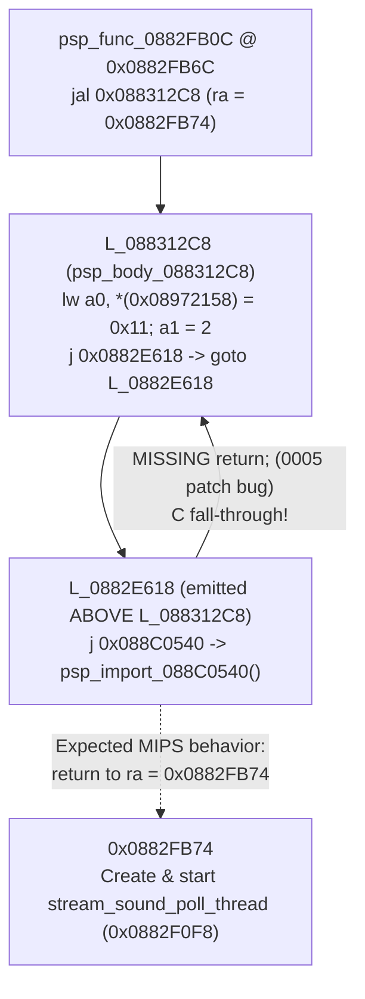

# 작업 로그: 첫 프레임 뒤 멈춤 원인 측정 (issue #6)

* 이슈: [#6](https://github.com/reexec/reDMP2/issues/6)
* 설계: [20261121-i006-frame-stall.md](../design/20261121-i006-frame-stall.md)
* 브랜치: `i006-frame-stall`
* 기준 환경: `reDMP2` `v0.0.3` (리프트 패치 `0007`/`0008`) + `third_party/repsp` `i69-poll-timeouts` (`7ee04b9`)

---

## 1. 측정 진단 추가 (`src/recomp_abi/trap.c`)

* `repsp`를 수정하지 않고 `reDMP2` 측 `psp_hle_call()`([trap.c](../../src/recomp_abi/trap.c))에 환경 변수 게이트 진단 `REDMP2_TRACE_NID` / `REDMP2_TRACE_NID_LIMIT`를 추가했습니다.
* `REDMP2_TRACE_NID`가 설정되지 않은 기본 실행에서는 최초 1회 확인 후 분기 1회만 거치며 동작·출력에 영향이 없습니다.
* 설정 시 일치하는 NID 호출의 `$ra`, `$sp`, `$a0..$a3`, `$s0`, `$s1`, 반환값 `$v0`를 최대 `REDMP2_TRACE_NID_LIMIT`(기본 16)회까지 `stderr`에 기록합니다.

---

## 2. 측정 명령 및 결과

```powershell
$env:REDMP2_TRACE_NID = "0x1FB15A32"
$env:REDMP2_TRACE_NID_LIMIT = "10"
.\build\win64-release\Release\redmp2.exe roms --headless --max-vblanks 10 `
  --save-dir "$env:TEMP\redmp2-i006-nid\save" --crash-dir "$env:TEMP\redmp2-i006-nid\crash"
```

### 실측 출력 요약 (**확인됨**)
```text
[REDMP2_TRACE_NID #1..#10] nid=0x1FB15A32 ra=0x0882FB74 sp=0x09FBF400 a0=0x00000011 a1=0x00000002 a2=0x00000000 a3=0x00008000 s0=0x08E2B010 s1=0x00000000 -> v0=0x00000000
  Class:       (e) VBlank limit reached (--max-vblanks)
  Present:     1 frames (interval mean=0.00 ms, max=0.00 ms)
  ThreadManForUser:sceKernelDelayThread: 31 calls
  ThreadManForUser:sceKernelSetEventFlag: 1243377 calls
  sceSasCore:__sceSasCore: 32 calls
```

---

## 3. 원인 확정 (**확인됨**)



1. **호출 지점(`$ra = 0x0882FB74`)**:
   * `psp_func_0882FB0C`는 `sound_poll_thread`(`0x0882FAE4`, 문자열 `0x088CA0D0`)를 생성·시작한 직후 `0x0882FB6C`에서 `jal 0x088312C8`을 호출하고, 복귀 지점 `0x0882FB74`에서 두 번째 스레드 `stream_sound_poll_thread`(`0x0882F0F8`, 문자열 `0x088CA0E4`)를 생성·시작하려 합니다.
2. **원본 MIPS 코드에는 반복문이 없음**:
   * `0x088312C8`: `0x08972158`에서 이벤트 플래그 핸들 `0x11`을 `$a0`로 읽고 `$a1 = 2`를 설정한 뒤 `j 0x0882E618`로 꼬리 점프합니다.
   * `0x0882E618`: `j 0x088C0540`(`sceKernelSetEventFlag` 임포트 스텁) + `nop`. 실제 MIPS에서는 1회 호출 후 `$ra`(`0x0882FB74`)로 즉시 복귀합니다.
   * 따라서 설계 §2의 가설 H1(사운드 스레드 명령 바쁜 대기)과 H2(GE/VBlank 콜백 대기)는 모두 사실이 아닙니다.
3. **리프터 코드 생성 결함 (`patches/psprecomp/0005-emit-trampoline.patch` + `an->funcs` 내 임포트 스텁)**:
   * `psp_body_088312C8`(`dmp2_funcs_028.c:5695..5718`)는 `0x0882E618`을 같은 함수에 병합해 주소 오름차순으로 `L_088312C8:` **바로 위**에 출력합니다.
   * `BOOT.BIN`(`ET_EXEC`)에서 임포트 스텁 `0x088C0540`은 `is_import(an, 0x088C0540)`이 참이면서 동시에 `an->funcs`에도 등록되어 `is_function(an, 0x088C0540)`도 참입니다(`dmp2_funcs_121.c:psp_func_088C0540`, `dmp2_register.c:35894`).
   * `emit_static_call_tail()`(`emit.c:142`)은 `is_import`를 먼저 검사해 `return;` 없이 `psp_import_088C0540();`만 출력하고, `in.is_jump` 호출부(`emit.c:1051`, `0005-emit-trampoline.patch:131`)는 `if (!c->trampoline || !is_function(an, in.target))` 조건으로 `return;` 출력을 건너뜁니다.
   * 결과적으로 `L_0882E618:` 뒤에 `return;`이 빠져 `L_088312C8:` → `goto L_0882E618;` 무한 루프가 리프터에 의해 합성됩니다.
   * 생성 코드 전수 검사 결과 `return;`이 누락된 `j <import>` 지점은 총 **13곳**이며, 12곳은 C 함수 끝(`}`) 직전이라 우연히 복귀하지만 `0x0882E618`만 다음 레이블(`L_088312C8`)로 폴스루합니다.

---

## 4. 검증

* Win64 Release(`build/win64-release`) 빌드 경고 **0건**, CTest **32/32 통과**(4.29초; CI 기준 30개 테스트 + `app_smoke_registered_roms` + `app_lift_check`).
* `REDMP2_TRACE_NID=0x1FB15A32` 재실행 시 동일한 `$ra = 0x0882FB74` 결과를 재현했습니다.
* 이번 단계는 원인 측정 전용이므로 멈춤 수정(`0005-emit-trampoline.patch` 패치 등)은 적용하지 않았습니다.

---

# Work Log: Measuring the Cause of the Stall After the First Frame (issue #6)

* Issue: [#6](https://github.com/reexec/reDMP2/issues/6)
* Design: [20261121-i006-frame-stall.md](../design/20261121-i006-frame-stall.md)
* Branch: `i006-frame-stall`
* Setup: `reDMP2` `v0.0.3` (lift patches `0007`/`0008`) + `third_party/repsp` `i69-poll-timeouts` (`7ee04b9`)

---

## 1. Env-Gated Diagnostic (`src/recomp_abi/trap.c`)

* Added an env-gated HLE call-site tracer (`REDMP2_TRACE_NID`, `REDMP2_TRACE_NID_LIMIT`) in `reDMP2`'s `psp_hle_call()` ([trap.c](../../src/recomp_abi/trap.c)), without touching `repsp`.
* Off by default (one-time `getenv` check, no behavioral or output change when unset). When set, logs `$ra`, `$sp`, `$a0..$a3`, `$s0`, `$s1`, and return `$v0` to `stderr` for matching NID calls up to the configured limit.

---

## 2. Measurement Command & Output (**confirmed**)

```powershell
$env:REDMP2_TRACE_NID = "0x1FB15A32"
$env:REDMP2_TRACE_NID_LIMIT = "10"
.\build\win64-release\Release\redmp2.exe roms --headless --max-vblanks 10 `
  --save-dir "$env:TEMP\redmp2-i006-nid\save" --crash-dir "$env:TEMP\redmp2-i006-nid\crash"
```

* Every `sceKernelSetEventFlag` (`0x1FB15A32`) call logged `$ra = 0x0882FB74`, `$sp = 0x09FBF400`, `$a0 = 0x00000011`, `$a1 = 0x00000002`, `v0 = 0x00000000` (1,243,377 calls in 10 vblanks; `sound_poll_thread` ran 31 delays / 32 SAS calls; 1 frame presented).

---

## 3. Confirmed Root Cause

1. **Call site (`$ra = 0x0882FB74`)**: `psp_func_0882FB0C` calls `jal 0x088312C8` at `0x0882FB6C` right after starting `sound_poll_thread` (`0x0882FAE4`) and immediately before `0x0882FB74`, which creates and starts `stream_sound_poll_thread` (`0x0882F0F8`).
2. **No busy loop in the original guest code**: `0x088312C8` loads event flag handle `0x11` from `0x08972158`, sets `$a1 = 2`, and tail-jumps to `0x0882E618`, which executes `j 0x088C0540` (`sceKernelSetEventFlag`) and returns once to `$ra = 0x0882FB74`. Both hypotheses H1 and H2 in the design document are refuted.
3. **Lifter codegen bug (`patches/psprecomp/0005-emit-trampoline.patch` + import stubs in `an->funcs`)**:
   * `psp_body_088312C8` (`dmp2_funcs_028.c:5695..5718`) pulls `0x0882E618` into the same C function and emits `L_0882E618:` directly above `L_088312C8:` (ascending address order).
   * For `BOOT.BIN` (`ET_EXEC`), import stub `0x088C0540` satisfies **both** `is_import(an, 0x088C0540)` and `is_function(an, 0x088C0540)` (`dmp2_funcs_121.c:psp_func_088C0540`).
   * `emit_static_call_tail()` checks `is_import` first and emits `psp_import_088C0540();` without `return;`, whereas the `in.is_jump` site patched by `0005-emit-trampoline.patch` guards `return;` with `if (!c->trampoline || !is_function(an, in.target))` and therefore omits `return;`.
   * C control flow falls through from `L_0882E618:` into `L_088312C8:` → `goto L_0882E618;`, creating a lifter-synthesized infinite loop.
   * Across all generated `dmp2_funcs_*.c`, **13** `j <import>` sites omit `return;`; 12 happen to sit right before `}`, while `0x0882E618` falls through into `L_088312C8`.

---

## 4. Verification

* Win64 Release (`build/win64-release`): **0 warnings**, **32/32 CTest passed** (4.29 s; all 30 CI tests plus `app_smoke_registered_roms` and `app_lift_check`).
* Re-running with `REDMP2_TRACE_NID=0x1FB15A32` reproduced `$ra = 0x0882FB74` identically.
* Per the design, no fix is applied in this measurement step.
