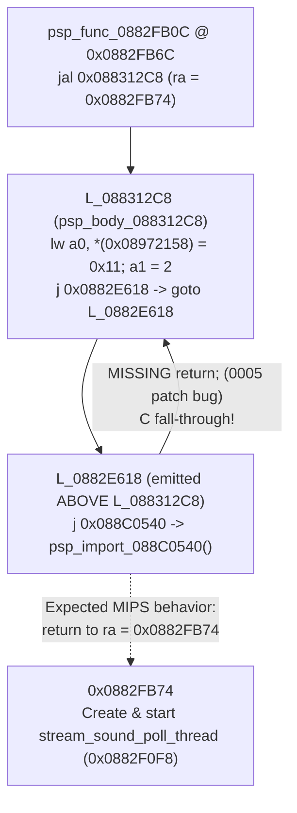

# 작업 로그: 첫 프레임 뒤 멈춤 원인 측정 (issue #6)

* 이슈: [#6](https://github.com/reexec/reDMP2/issues/6)
* 설계: [20261121-i006-frame-stall.md](../design/20261121-i006-frame-stall.md)
* 브랜치: `i006-frame-stall`
* 기준 환경: `reDMP2` `v0.0.3` (리프트 패치 `0007`/`0008`) + `third_party/repsp` `i69-poll-timeouts` (`7ee04b9`)

---

## 1. 측정 진단 추가 (`src/recomp_abi/trap.c`)

* `repsp`를 수정하지 않고 `reDMP2` 측 `psp_hle_call()`([trap.c](../../src/recomp_abi/trap.c))에 환경 변수 게이트 진단 `REDMP2_TRACE_NID` / `REDMP2_TRACE_NID_LIMIT`를 추가했습니다.
* `REDMP2_TRACE_NID`가 설정되지 않은 기본 실행에서는 최초 1회 확인 후 분기 1회만 거치며 동작·출력에 영향이 없습니다.
* 설정 시 일치하는 NID 호출의 `$ra`, `$sp`, `$a0..$a3`, `$s0`, `$s1`, 반환값 `$v0`를 최대 `REDMP2_TRACE_NID_LIMIT`(기본 16)회까지 `stderr`에 기록합니다.

---

## 2. 측정 명령 및 결과

```powershell
$env:REDMP2_TRACE_NID = "0x1FB15A32"
$env:REDMP2_TRACE_NID_LIMIT = "10"
.\build\win64-release\Release\redmp2.exe roms --headless --max-vblanks 10 `
  --save-dir "$env:TEMP\redmp2-i006-nid\save" --crash-dir "$env:TEMP\redmp2-i006-nid\crash"
```

### 실측 출력 요약 (**확인됨**)
```text
[REDMP2_TRACE_NID #1..#10] nid=0x1FB15A32 ra=0x0882FB74 sp=0x09FBF400 a0=0x00000011 a1=0x00000002 a2=0x00000000 a3=0x00008000 s0=0x08E2B010 s1=0x00000000 -> v0=0x00000000
  Class:       (e) VBlank limit reached (--max-vblanks)
  Present:     1 frames (interval mean=0.00 ms, max=0.00 ms)
  ThreadManForUser:sceKernelDelayThread: 31 calls
  ThreadManForUser:sceKernelSetEventFlag: 1243377 calls
  sceSasCore:__sceSasCore: 32 calls
```

---

## 3. 원인 확정 (**확인됨**)



1. **호출 지점(`$ra = 0x0882FB74`)**:
   * `psp_func_0882FB0C`는 `sound_poll_thread`(`0x0882FAE4`, 문자열 `0x088CA0D0`)를 생성·시작한 직후 `0x0882FB6C`에서 `jal 0x088312C8`을 호출하고, 복귀 지점 `0x0882FB74`에서 두 번째 스레드 `stream_sound_poll_thread`(`0x0882F0F8`, 문자열 `0x088CA0E4`)를 생성·시작하려 합니다.
2. **원본 MIPS 코드에는 반복문이 없음**:
   * `0x088312C8`: `0x08972158`에서 이벤트 플래그 핸들 `0x11`을 `$a0`로 읽고 `$a1 = 2`를 설정한 뒤 `j 0x0882E618`로 꼬리 점프합니다.
   * `0x0882E618`: `j 0x088C0540`(`sceKernelSetEventFlag` 임포트 스텁) + `nop`. 실제 MIPS에서는 1회 호출 후 `$ra`(`0x0882FB74`)로 즉시 복귀합니다.
   * 따라서 설계 §2의 가설 H1(사운드 스레드 명령 바쁜 대기)과 H2(GE/VBlank 콜백 대기)는 모두 사실이 아닙니다.
3. **리프터 코드 생성 결함 (`patches/psprecomp/0005-emit-trampoline.patch` + `an->funcs` 내 임포트 스텁)**:
   * `psp_body_088312C8`(`dmp2_funcs_028.c:5695..5718`)는 `0x0882E618`을 같은 함수에 병합해 주소 오름차순으로 `L_088312C8:` **바로 위**에 출력합니다.
   * `BOOT.BIN`(`ET_EXEC`)에서 임포트 스텁 `0x088C0540`은 `is_import(an, 0x088C0540)`이 참이면서 동시에 `an->funcs`에도 등록되어 `is_function(an, 0x088C0540)`도 참입니다(`dmp2_funcs_121.c:psp_func_088C0540`, `dmp2_register.c:35894`).
   * `emit_static_call_tail()`(`emit.c:142`)은 `is_import`를 먼저 검사해 `return;` 없이 `psp_import_088C0540();`만 출력하고, `in.is_jump` 호출부(`emit.c:1051`, `0005-emit-trampoline.patch:131`)는 `if (!c->trampoline || !is_function(an, in.target))` 조건으로 `return;` 출력을 건너뜁니다.
   * 결과적으로 `L_0882E618:` 뒤에 `return;`이 빠져 `L_088312C8:` → `goto L_0882E618;` 무한 루프가 리프터에 의해 합성됩니다.
   * 생성 코드 전수 검사 결과 `return;`이 누락된 `j <import>` 지점은 총 **13곳**이며, 12곳은 C 함수 끝(`}`) 직전이라 우연히 복귀하지만 `0x0882E618`만 다음 레이블(`L_088312C8`)로 폴스루합니다.

---

## 4. 검증 (원인 측정 단계)

* Win64 Release(`build/win64-release`) 빌드 경고 **0건**, CTest **32/32 통과**(4.29초; CI 기준 30개 테스트 + `app_smoke_registered_roms` + `app_lift_check`).
* `REDMP2_TRACE_NID=0x1FB15A32` 재실행 시 동일한 `$ra = 0x0882FB74` 결과를 재현했습니다.

---

## 5. 수정 적용 및 검증 (설계 §5: 패치 `0009` + `0010`)

1. **Fix 1 — `patches/psprecomp/0009-tail-jump-import-return.patch`**:
   * `0005-emit-trampoline.patch`(upstream PR #37)는 변경하지 않고 유지했습니다.
   * `emit.c`의 `in.is_jump` 꼬리 호출 경로 조건을 `if (!c->trampoline || is_import(an, in.target) || !is_function(an, in.target))`으로 수정해 `j <import>`가 항상 `return;`을 출력하도록 했습니다.
   * `emit.c`의 다른 꼬리 호출 경로(fall-out L778, likely branch L893, ordinary branch L925-935, end fall-through L1094)도 모두 점검해 `return;` 누락이 없음을 확인했습니다.
2. **Fix 2 — `patches/psprecomp/0010-exclude-import-stubs-from-funcs.patch`**:
   * 임포트 스텁(`0x088C0540` 등)이 `an->funcs`에 들어간 원인은 `0007`/`0008`이 아니라(둘 다 이미 `!is_import_stub()` + `.text` 범위 검사를 수행), upstream `analyze.c`가 `.sceStub.text`가 `a_in_range()` 바깥에 있다고 가정하고 `trace_function()`(`in.is_branch` L208, `in.is_jump` L249) 및 `a_discover()`(초기 시드 L495, 재탐색 타깃 L646)에서 `is_import_stub()`을 검사하지 않았기 때문입니다.
   * `0010` 패치로 위 4곳 모두에 `!is_import_stub(an, ...)` 필터를 추가하고 `CMakeLists.txt`와 `patches/psprecomp/README.md`를 갱신했습니다.
3. **재생성 및 정적 감사 결과 (**확인됨**)**:
   * `BOOT.BIN`: 함수 `8,014` → **`7,978`**(`-36`, `.sceStub.text` `0x088C03D0..0x088C0AF8` 내 함수 **`0`**개), 내부 진입점 `28,109`, `.text` 커버리지 `759,000 / 772,856` B (`98.2%`), 고유 임포트 `211`, 점프 테이블 `365` → `4,670`.
   * 기존 `return;` 누락 `j <import>` 13곳 모두 `return;` 포함(`13/13`, 누락 `0`).
   * `tools/lift_audit.py`: `7,978` 본문 / `125` 파일 감사, `Data misread as code: 0`, **`Mismatches found: 0`**(기존 12건 모두 해소), `Tail-call-only cycles (SCCs): 284`.
   * `reDMP1` 비교(읽기 전용): PRX `BOOT.BIN` `funcs` `9,024` → **`9,004`**(`761,828` B, `92.5%`, 8바이트 임포트 스텁 20개 제거). `reDMP1` 생성 코드의 `j <import>` 지점은 `0`건으로 `0009` 결함 해당 없음.
4. **빌드·CTest·헤드리스 부팅 검증 (**확인됨**)**:
   * 청크 수가 126→125로 줄어 남은 이전 `dmp2_funcs_125.c`를 제거하고 재구성 후 Win64 Release 빌드: **경고 0건**, CTest **32/32 통과**(4.20초).
   * 헤드리스 600 VBlank 실행(`redmp2.exe roms --headless --max-vblanks 600 --save-dir <temp> --crash-dir <temp>`):
     * **정지 분류 / 종료 코드**: `(e) VBlank limit reached (--max-vblanks)` / `0` (새 미구현 NID 없음, 디스패치 `0`).
     * **표시 프레임**: **`298` 프레임** (`interval mean=33.65 ms, max=83.46 ms`, `sceDisplayWaitVblankStart` 596회, `sceDisplaySetFrameBuf` 300회, `sceCtrlReadBufferPositive` 299회).
     * **`sceKernelSetEventFlag` 호출 수**: `72,004,166` → **`300`회**.
     * **오프닝 재생**: `stream_sound_poll_thread`(`0x0882F0F8`)와 `soundThread`(`0x0882DF74`)가 정상 기동되었고 `disc0:/PSP_GAME/USRDIR/movie/opening.pmf` 재생에 진입(`sceMpegAvcDecode` 302회, `sceMpegAtracDecode` 225회).
5. **리뷰 보완 (`0010`에 임포트 스텁 디스패치 등록 추가)**:
   * `0010`으로 임포트 스텁을 `an->funcs`에서 제외하면서 `dmp2_register.c`에 임포트 스텁 주소가 등록되지 않아 함수 포인터 간접 호출(`jalr`) 시 디스패치 미스가 발생할 수 있는 문제를 보완했습니다.
   * 같은 변경의 짝이므로 별도 패치 대신 `0010-exclude-import-stubs-from-funcs.patch`의 `emit.c`(`psp_recomp_register()`)에 모든 `an->imports[i]`를 `psp_register(0x%08Xu, psp_import_%08X);`로 등록하도록 추가했습니다.
   * 재생성 결과 `1 of 128 files changed`(`dmp2_register.c`만 갱신): 총 등록 `36,298`건(`7,978` 함수 + `211` `psp_import_*` + `28,109` 내부 레이블), 고유 주소 `36,298`건(**중복 `0`건**).
   * `lift_audit`: `7,978` 본문 / `125` 파일, `Data misread as code: 0`, `Mismatches found: 0`, `284` SCCs.
   * Win64 Release 빌드 **경고 0건**, CTest **32/32 통과**(3.85초), 600 VBlank 헤드리스 실행 **297 프레임**(`mean=33.71 ms`, `SetEventFlag` 300회, `sceMpegAvcDecode` 302회, `sceMpegAtracDecode` 225회, 종료 코드 `0`).

---

# Work Log: Measuring the Cause of the Stall After the First Frame (issue #6)

* Issue: [#6](https://github.com/reexec/reDMP2/issues/6)
* Design: [20261121-i006-frame-stall.md](../design/20261121-i006-frame-stall.md)
* Branch: `i006-frame-stall`
* Setup: `reDMP2` `v0.0.3` (lift patches `0007`/`0008`) + `third_party/repsp` `i69-poll-timeouts` (`7ee04b9`)

---

## 1. Env-Gated Diagnostic (`src/recomp_abi/trap.c`)

* Added an env-gated HLE call-site tracer (`REDMP2_TRACE_NID`, `REDMP2_TRACE_NID_LIMIT`) in `reDMP2`'s `psp_hle_call()` ([trap.c](../../src/recomp_abi/trap.c)), without touching `repsp`.
* Off by default (one-time `getenv` check, no behavioral or output change when unset). When set, logs `$ra`, `$sp`, `$a0..$a3`, `$s0`, `$s1`, and return `$v0` to `stderr` for matching NID calls up to the configured limit.

---

## 2. Measurement Command & Output (**confirmed**)

```powershell
$env:REDMP2_TRACE_NID = "0x1FB15A32"
$env:REDMP2_TRACE_NID_LIMIT = "10"
.\build\win64-release\Release\redmp2.exe roms --headless --max-vblanks 10 `
  --save-dir "$env:TEMP\redmp2-i006-nid\save" --crash-dir "$env:TEMP\redmp2-i006-nid\crash"
```

* Every `sceKernelSetEventFlag` (`0x1FB15A32`) call logged `$ra = 0x0882FB74`, `$sp = 0x09FBF400`, `$a0 = 0x00000011`, `$a1 = 0x00000002`, `v0 = 0x00000000` (1,243,377 calls in 10 vblanks; `sound_poll_thread` ran 31 delays / 32 SAS calls; 1 frame presented).

---

## 3. Confirmed Root Cause

1. **Call site (`$ra = 0x0882FB74`)**: `psp_func_0882FB0C` calls `jal 0x088312C8` at `0x0882FB6C` right after starting `sound_poll_thread` (`0x0882FAE4`) and immediately before `0x0882FB74`, which creates and starts `stream_sound_poll_thread` (`0x0882F0F8`).
2. **No busy loop in the original guest code**: `0x088312C8` loads event flag handle `0x11` from `0x08972158`, sets `$a1 = 2`, and tail-jumps to `0x0882E618`, which executes `j 0x088C0540` (`sceKernelSetEventFlag`) and returns once to `$ra = 0x0882FB74`. Both hypotheses H1 and H2 in the design document are refuted.
3. **Lifter codegen bug (`patches/psprecomp/0005-emit-trampoline.patch` + import stubs in `an->funcs`)**:
   * `psp_body_088312C8` (`dmp2_funcs_028.c:5695..5718`) pulls `0x0882E618` into the same C function and emits `L_0882E618:` directly above `L_088312C8:` (ascending address order).
   * For `BOOT.BIN` (`ET_EXEC`), import stub `0x088C0540` satisfies **both** `is_import(an, 0x088C0540)` and `is_function(an, 0x088C0540)` (`dmp2_funcs_121.c:psp_func_088C0540`).
   * `emit_static_call_tail()` checks `is_import` first and emits `psp_import_088C0540();` without `return;`, whereas the `in.is_jump` site patched by `0005-emit-trampoline.patch` guards `return;` with `if (!c->trampoline || !is_function(an, in.target))` and therefore omits `return;`.
   * C control flow falls through from `L_0882E618:` into `L_088312C8:` → `goto L_0882E618;`, creating a lifter-synthesized infinite loop.
   * Across all generated `dmp2_funcs_*.c`, **13** `j <import>` sites omit `return;`; 12 happen to sit right before `}`, while `0x0882E618` falls through into `L_088312C8`.

---

## 4. Verification (Measurement Step)

* Win64 Release (`build/win64-release`): **0 warnings**, **32/32 CTest passed** (4.29 s; all 30 CI tests plus `app_smoke_registered_roms` and `app_lift_check`).
* Re-running with `REDMP2_TRACE_NID=0x1FB15A32` reproduced `$ra = 0x0882FB74` identically.

---

## 5. Fixes & Verification (Design §5: Patches `0009` & `0010`)

1. **Fix 1 (`patches/psprecomp/0009-tail-jump-import-return.patch`)**: Kept `0005-emit-trampoline.patch` unchanged; updated `emit.c`'s `in.is_jump` tail-call path to `if (!c->trampoline || is_import(an, in.target) || !is_function(an, in.target))` so `j <import>` always emits `return;`. Audited all other tail-call paths in `emit.c` (fall-out, likely branch, ordinary branch, end fall-through) and confirmed none share the defect.
2. **Fix 2 (`patches/psprecomp/0010-exclude-import-stubs-from-funcs.patch`)**: Confirmed that neither `0007` nor `0008` seeded import stubs (both already check `!is_import_stub()` and `.text` bounds); instead, upstream `analyze.c` omitted `!is_import_stub()` in `trace_function()` (`in.is_branch`, `in.is_jump`) and `a_discover()` (initial seeds and fixpoint re-walk targets). Added `!is_import_stub()` at all four sites and updated `CMakeLists.txt` and `patches/psprecomp/README.md`.
3. **Regeneration & audit (**confirmed**)**:
   * `BOOT.BIN`: `7,978` functions (`-36`, **`0`** functions inside `.sceStub.text` `0x088C03D0..0x088C0AF8`), `28,109` interior entries, `759,000 / 772,856` B (`98.2%`), `211` imports, `365` tables → `4,670` targets.
   * All **13/13** former `j <import>` sites now emit `return;` (`0` missing).
   * `tools/lift_audit.py`: `7,978` bodies across `125` files, `Data misread as code: 0`, **`Mismatches found: 0`** (all 12 prior mismatches resolved), `284` tail-call SCCs.
   * `reDMP1` comparison (read-only): `funcs` drops from `9,024` to **`9,004`** (`761,828` B, `92.5%`, `-20` stub functions / `-160` B); `reDMP1` generated code has `0` `j <import>` sites.
4. **Build, CTest & headless boot (**confirmed**)**:
   * Removed stale `dmp2_funcs_125.c` (chunk count dropped 126 → 125), reconfigured, built Win64 Release with **0 warnings**, CTest **32/32 passed** (4.20 s).
   * Headless 600-vblank run exits cleanly at `(e) VBlank limit reached` (exit code `0`, `0` dispatches, no new unimplemented NID), presenting **298 frames** (`mean=33.65 ms`, `sceDisplayWaitVblankStart` 596 calls, `sceDisplaySetFrameBuf` 300 calls, `sceCtrlReadBufferPositive` 299 calls), `sceKernelSetEventFlag` **`300` calls** (down from `72,004,166`), with `stream_sound_poll_thread` and `soundThread` running and `opening.pmf` playing (`sceMpegAvcDecode` 302 calls, `sceMpegAtracDecode` 225 calls).
5. **Review follow-up (registering `psp_import_*` in `0010`)**:
   * Folded `emit.c` dispatch registration into `0010-exclude-import-stubs-from-funcs.patch` (same logical change): `psp_recomp_register()` now emits `psp_register(0x%08Xu, psp_import_%08X);` for every `an->imports[i]` so indirect calls (`jalr`) to an import stub reach the HLE.
   * Regeneration changed only `dmp2_register.c` (`1 of 128 files`): `36,298` total registrations (`7,978` funcs + `211` `psp_import_*` + `28,109` interior labels), `36,298` unique (**`0` duplicates**).
   * `lift_audit`: `7,978` bodies / `125` files, `Data misread as code: 0`, `Mismatches found: 0`, `284` SCCs.
   * Win64 Release build: **0 warnings**, CTest **32/32 passed** (3.85 s), headless 600-vblank run **297 frames** (`mean=33.71 ms`, `SetEventFlag` 300 calls, `sceMpegAvcDecode` 302, `sceMpegAtracDecode` 225, exit code `0`).
